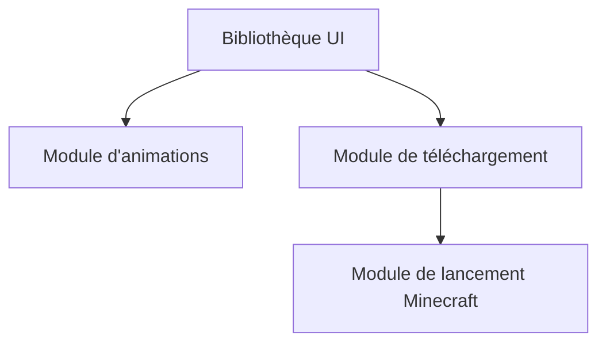

# Meloong-Git/PCL

> Mirror of the source code of Plain Craft Launcher, a Minecraft launcher, for Chinese-speaking players.

## The problem
Launching Minecraft and managing its versions and mods requires a dedicated tool. This repository is only the published code.

## What it actually does
The README (in Chinese, very short) says the repository contains most of the code: UI library, animations, download module, Minecraft launch module. The code is not updated continuously: it is synchronized with each PCL release.

## How it is wired

Diagram not provided: this view is deduced from the module list in the README.

## Trying it
```bash
# Aucune commande documentée. Le README renvoie vers le téléchargement de la version officielle.
```

## Cost and gotchas
Free. A license is present but not identified by GitHub: read it before any reuse. Nearly empty README.

## What it is not
It is not an open development repository: the code is a snapshot synchronized with each release. Nothing to do with data or AI.

## Alternatives
None named in the README.

## For you
Ignore: a game launcher unrelated to a data / AI / MLOps profile, and with a vague license.
