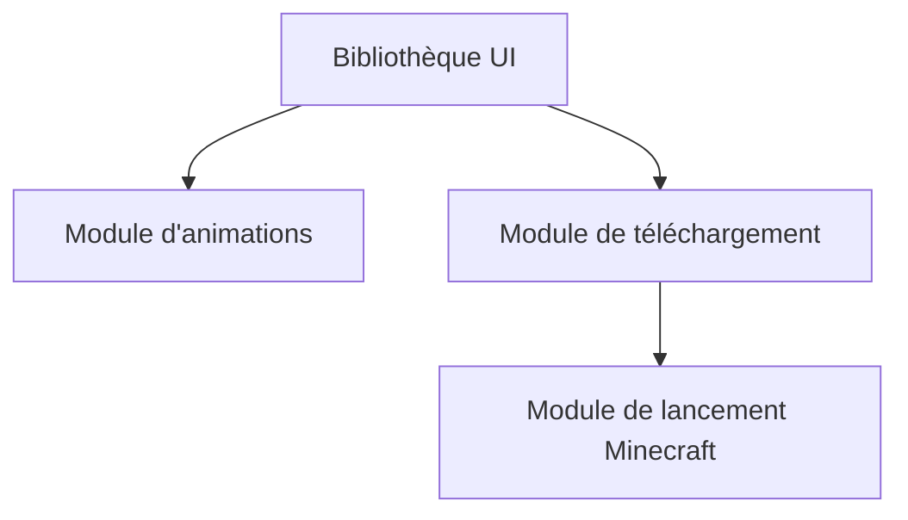

# Meloong-Git/PCL

> Miroir du code source de Plain Craft Launcher, lanceur Minecraft, pour joueurs sinophones.

## Le problème
Lancer Minecraft et gérer ses versions et mods demande un outil dédié. Ce dépôt n'en est que le code publié.

## Ce que ça fait vraiment
Le README (en chinois, très court) dit que le dépôt contient l'essentiel du code : bibliothèque d'UI, animations, module de téléchargement, module de lancement Minecraft. Le code n'est pas mis à jour en continu : il est synchronisé à chaque publication de PCL.

## Comment c'est branché

Schéma non fourni : cette vue est déduite de la liste des modules du README.

## Essayer
```bash
# Aucune commande documentée. Le README renvoie vers le téléchargement de la version officielle.
```

## Coût et pièges
Gratuit. Licence présente mais non identifiée par GitHub : à lire avant toute réutilisation. README quasi vide.

## Ce que ce n'est pas
Ce n'est pas un dépôt de développement ouvert : le code est un instantané synchronisé à chaque release. Aucun rapport avec la data ou l'IA.

## Alternatives
Aucune nommée dans le README.

## Pour toi
Ignorer : un lanceur de jeu sans lien avec un profil data / IA / MLOps, et une licence floue.

