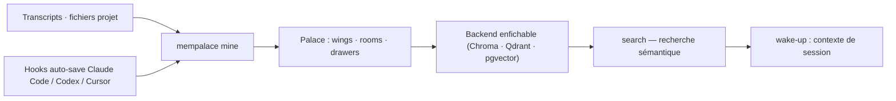

# MemPalace/mempalace

> Local memory for agents: verbatim storage of conversations, semantic search, no API calls.

## The problem
Code snippets have expiration dates; once they expire, they disappear. Layers of memory that summarize or paraphrase information lose the specific details that will be needed later.

## What it actually does
Stores the history verbatim – without summarization or extraction – and retrieves it through semantic search. The index is structured: people and projects become *wings*, the topics become *rooms*, and the original content resides in *drawers*, which allows for targeted searches. The retrieval backend is pluggable (ChromaDB by default; sqlite_exact, rust_exact, Milvus, Qdrant, pgvector). 45 MCP tools, a temporal knowledge graph with validity windows, and auto-save hooks for Claude Code, Codex CLI, and Cursor.

## How it is wired


## Trying it
```bash
uv tool install mempalace
mempalace init ~/projects/myapp
mempalace mine ~/.claude/projects/ --mode convos
mempalace search "why did we switch to GraphQL"
mempalace wake-up
```

## Cost and gotchas
Free, Python 3.9+. Approximately 300 MB of disk space for the embedding model (80 MB for minilm). No API key is required for the reference path. Be aware of Docker mounting permissions under Linux (uid 1000) and the limited GPU image to x86_64. The README explicitly warns about **fake websites**: only official sources, this repository, the PyPI package, and mempalaceofficial.com.

## What it is not
This is not a cloud service: nothing leaves your machine except for explicitly opted-in data. The native Termux is not supported (only for Linux). The README deliberately avoids any comparison with Mem0, Zep, or Supermemory, as the metrics are not comparable.

## Alternatives
- mem0, Mastra, Hindsight, Supermemory, Zep: These were mentioned as neighboring projects, without any quantified comparison.

## For you
To adopt: this is the locally relevant and verifiable solution to the agent memory problem, with reproducible benchmarks available from the repository.
