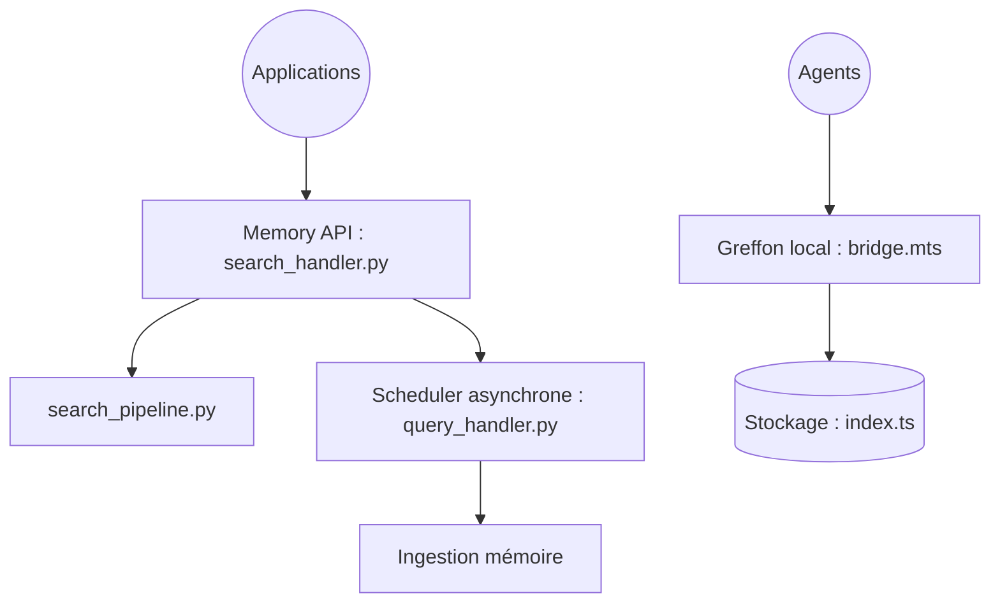

# MemOS

> Long-term memory system for agents and LLMs, as a hosted API, self-hosted service or plugin.

## The problem
Agents forget from one session to the next, and embedding stores are black boxes that are hard to correct.

## What it actually does
A single API to add, search, modify and delete memories structured as a graph, with multiple memory cubes, asynchronous ingestion and natural-language correction feedback. Four entry paths: cloud API, self-hosting (Neo4j + Qdrant), cloud plugin (OpenClaw, DeepSeek Harness) and local SQLite plugin.

## How it is wired


## Trying it
```bash
git clone https://github.com/MemTensor/MemOS.git
cd MemOS
cp docker/.env.example .env
cd docker
docker compose up
```

## Cost and gotchas
LLM keys must be filled in `.env`; Neo4j and Qdrant must be run. The cloud API requires a key (`mpg-`). The local plugin is installed via a `curl | bash` script.

## What it is not
Not a simple conversation cache. The benchmark scores (LoCoMo, LongMemEval) are the authors' own, using their own evaluation tool.

## Alternatives
No alternative cited in the README.

## For you
Worth watching: a central topic for your agents, but the results are self-reported and the stack (graph, vectors) is heavy.
