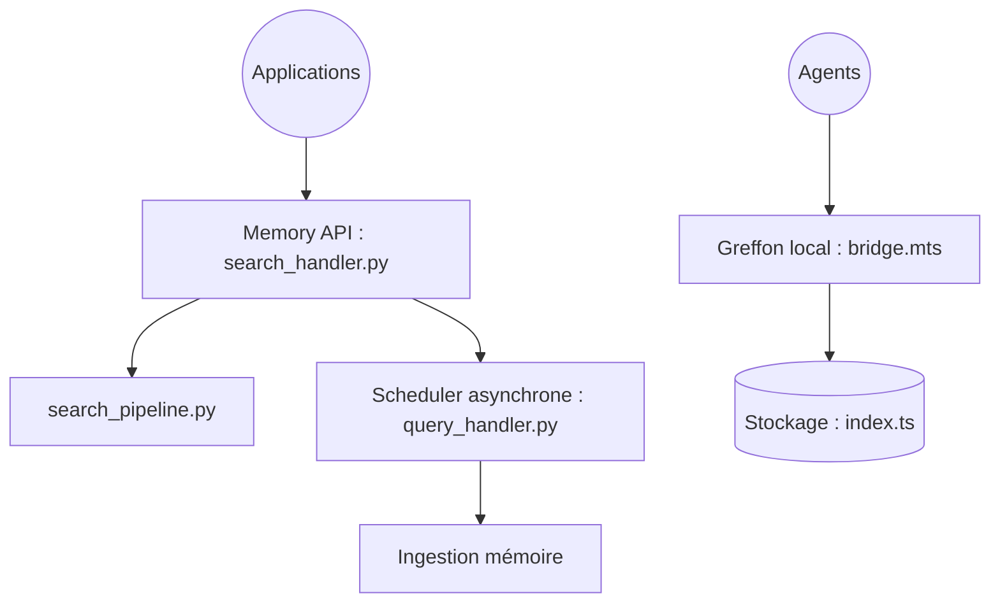

# MemOS

> Système de mémoire long terme pour agents et LLM, en API hébergée, service auto-hébergé ou greffon.

## Le problème
Les agents oublient d'une session à l'autre et les magasins d'embeddings sont des boîtes noires difficiles à corriger.

## Ce que ça fait vraiment
Une API unique pour ajouter, chercher, modifier et supprimer des souvenirs structurés en graphe, avec cubes de mémoire multiples, ingestion asynchrone et retour de correction en langage naturel. Quatre voies d'entrée : API cloud, auto-hébergement (Neo4j + Qdrant), greffon cloud (OpenClaw, DeepSeek Harness) et greffon local SQLite.

## Comment c'est branché


## Essayer
```bash
git clone https://github.com/MemTensor/MemOS.git
cd MemOS
cp docker/.env.example .env
cd docker
docker compose up
```

## Coût et pièges
Clés LLM à renseigner dans `.env` ; Neo4j et Qdrant à faire tourner. L'API cloud demande une clé (`mpg-`). Le greffon local se pose via un script `curl | bash`.

## Ce que ce n'est pas
Pas un simple cache de conversation. Les scores de benchmarks (LoCoMo, LongMemEval) sont ceux des auteurs, avec leur propre outil d'évaluation.

## Alternatives
Aucune alternative citée dans le README.

## Pour toi
À surveiller : sujet central pour tes agents, mais les résultats sont auto-déclarés et la pile (graphe, vecteurs) est lourde.

