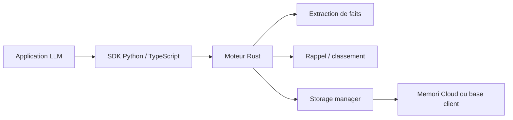

# MemoriLabs/Memori

> Persistent memory SDK for LLM agents, which captures, structures and recalls what the agent has done.

## The problem
Agents forget everything from one session to the next and rediscover the same things while burning tokens.

## What it actually does
You register an LLM client (OpenAI in the example) and attribute exchanges to an entity and a process. Memori persists the conversations, extracts facts from them (attributes, events, preferences, rules, skills…), then recalls them in later calls. Python and TypeScript SDKs around a Rust engine; OpenClaw and Hermes plugins, and an MCP server for Claude Code, Cursor, Codex. Without attribution, no memory is created.

## How it is wired


## Trying it
```bash
pip install memori
export MEMORI_API_KEY=[api_key]
python -m memori quota
```

## Cost and gotchas
A Memori key (account required) plus the LLM's key. Augmentation is free but limited by quota (IP, then key). BYODB mode lets you use your own database. The LoCoMo figure (87%) and the announced enterprise savings ($2.1M/year) come from the README, unverified.

## What it is not
Not entirely local: cloud mode is the default path. A license is present but not identified by GitHub.

## Alternatives
Zep, LangMem and Mem0 (cited as points of comparison).

## For you
Worth watching: handy for giving an agent a memory, but SaaS dependence and an unclear license need sorting out before any serious use.
