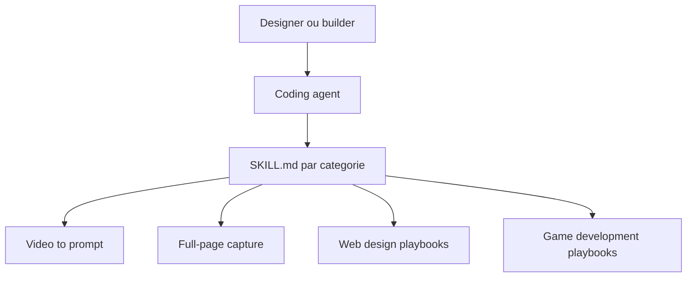

# MengTo/Skills

> Library of 176 agent skills for designing interfaces, Three.js games and illustrations.

## The problem
Coding agents produce generic web pages and visual effects when they are not given detailed design procedures.

## What it actually does
`SKILL.md` folders split into categories: web design (81), games (20), illustration (14, SVG styles), combat/VFX (6), Codex flows (19), media, workflow. Some include standalone HTML demos and scripts. The flagship flows: video to super-prompt, HTML to interaction prompts, full-page capture.

## How it is wired


## Trying it
No install command is documented; the README suggests listing the skills with:
```bash
find agent-skills -name SKILL.md | sort
```

## Cost and gotchas
Free. Several skills point to third-party services (ElevenLabs, Aura, Unsplash) that have their own terms.

## What it is not
Not a framework. No install guide: the README mentions "Add install notes" as a future task. The example paths (`/Users/mengto/...`) are the maintainer's.

## Alternatives
No alternative named in the README.

## For you
Ignore on the data/MLOps side: the content is centered on web design and games, with no link to your pipelines.
