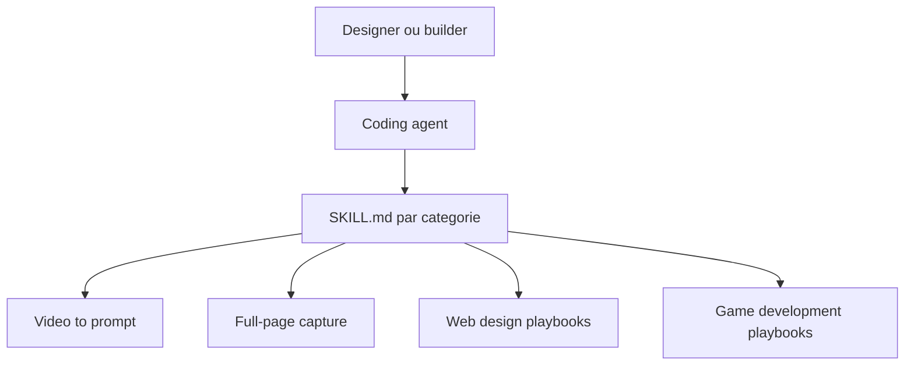

# MengTo/Skills

> Bibliothèque de 176 skills d'agents pour concevoir interfaces, jeux Three.js et illustrations.

## Le problème
Les agents de code produisent des pages web et des effets visuels génériques quand on ne leur donne pas de procédures de design détaillées.

## Ce que ça fait vraiment
Des dossiers `SKILL.md` répartis en catégories : web design (81), jeux (20), illustration (14, styles SVG), combat/VFX (6), flux Codex (19), médias, workflow. Certains incluent des démos HTML autonomes et des scripts. Les flux phares : vidéo vers super-prompt, HTML vers prompts d'interaction, capture de page complète.

## Comment c'est branché


## Essayer
Aucune commande d'installation n'est documentée ; le README conseille de lister les skills avec :
```bash
find agent-skills -name SKILL.md | sort
```

## Coût et pièges
Gratuit. Plusieurs skills renvoient à des services tiers (ElevenLabs, Aura, Unsplash) qui ont leurs propres conditions.

## Ce que ce n'est pas
Pas un framework. Pas de guide d'installation : le README évoque « Add install notes » comme tâche future. Les chemins d'exemple (`/Users/mengto/...`) sont ceux du mainteneur.

## Alternatives
Aucune alternative nommée dans le README.

## Pour toi
À ignorer côté data/MLOps : le contenu est centré design web et jeux, sans lien avec tes pipelines.

