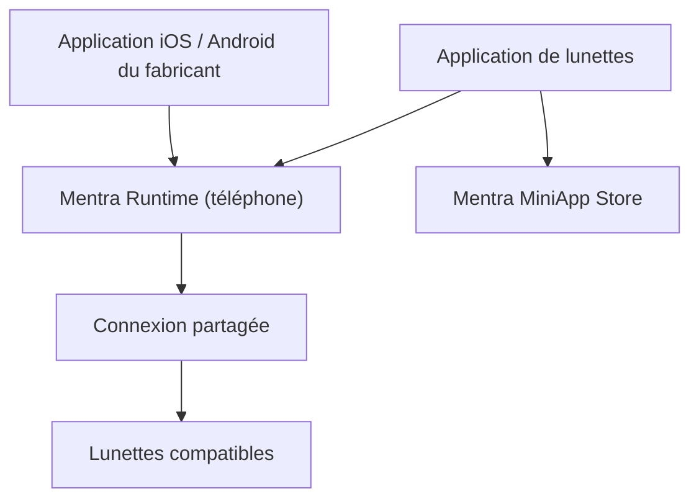

# Mentra-Community/MentraOS

> Open source system and runtime for writing smart glasses applications that work across brands.

## The problem
Each smart glasses brand has its own API: an application must be rewritten for each one.

## What it actually does
MentraOS runs glasses applications on the phone, inside a "Mentra Runtime", with a shared connection to the glasses. It handles pairing, data streams, hardware access (display, microphone, camera, speaker) and distribution through a mini-app store. Several applications run at the same time. Manufacturers can embed the runtime in their own iOS and Android applications.

## How it is wired
Simplified diagram based on the sheet, no diagram provided.

## Trying it
No command is documented in the README.

## Cost and gotchas
Free (Apache-2.0). You need compatible glasses and a phone. The repository has 827 open issues; the README says nothing about installation.

## What it is not
It is not a data or AI tool: the AI applications mentioned (notes, translation) are usage examples. Enterprise deployment is claimed, with no verifiable detail.

## Alternatives
No alternative named in the README.

## For you
Ignore: useful only if you develop for smart glasses; otherwise it has no link to data or MLOps work.
