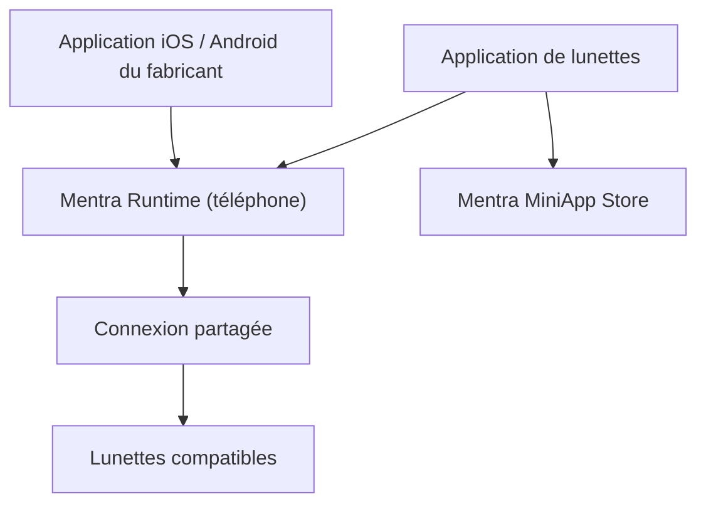

# Mentra-Community/MentraOS

> Système et runtime open source pour écrire des applications de lunettes connectées compatibles multi-marques.

## Le problème
Chaque marque de lunettes connectées a son API : une application doit être réécrite pour chacune.

## Ce que ça fait vraiment
MentraOS exécute les applications de lunettes sur le téléphone, dans un « Mentra Runtime », avec une connexion partagée aux lunettes. Il gère appairage, flux de données, accès au matériel (écran, micro, caméra, haut-parleur) et distribution via un magasin de mini-applications. Plusieurs applications tournent en même temps. Les fabricants peuvent intégrer le runtime dans leurs propres applications iOS et Android.

## Comment c'est branché
Schéma simplifié d'après la fiche, sans diagramme fourni.

## Essayer
Aucune commande documentée dans le README.

## Coût et pièges
Gratuit (Apache-2.0). Il faut des lunettes compatibles et un téléphone. Le dépôt compte 827 issues ouvertes ; le README ne dit rien de l'installation.

## Ce que ce n'est pas
Ce n'est pas un outil de data ou d'IA : les applications d'IA citées (notes, traduction) sont des exemples d'usage. Le déploiement en entreprise est revendiqué, sans détail vérifiable.

## Alternatives
Aucune alternative nommée dans le README.

## Pour toi
À ignorer : utile seulement si tu développes pour lunettes connectées ; hors de ce cas, aucun lien avec un travail data ou MLOps.

