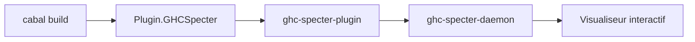

# MercuryTechnologies/ghc-specter

> GHC plugin and viewer that show the internal state of a Haskell compilation, for Haskell developers.

## The problem
During a Haskell compilation, it is hard to know which stage slows the build or what a faulty Template Haskell snippet is doing. You have to make do with GHC's logs or modify GHC.

## What it actually does
A GHC driver plugin collects information during compilation and sends it to a live visualization daemon. It is enabled through command-line options. You can also pause the compilation to inspect the internal state.

## How it is wired
Simplified diagram based on the fiche, no diagram provided.



## Trying it
```bash
nix develop
cabal run ghc-specter-daemon:exe:ghc-specter-daemon
cabal build --ghc-options "-fplugin Plugin.GHCSpecter -plugin-package ghc-specter-plugin"
```

## Cost and gotchas
Free, but it needs the Haskell toolchain (GHC, cabal, Nix to run the daemon). Last push in September 2025, so over a year ago: compatibility with recent GHC versions is not guaranteed.

## What it is not
Not a tool for other languages. Not a general profiler: it only serves GHC's compilation pipeline.

## Alternatives
No alternative named in the README.

## For you
To ignore: a tool reserved for Haskell developers, unrelated to data, AI or MLOps work, and barely active for over a year.
