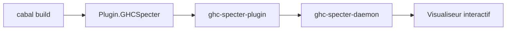

# MercuryTechnologies/ghc-specter

> Plugin GHC et visualiseur qui montrent l'état interne d'une compilation Haskell, pour développeurs Haskell.

## Le problème
Pendant une compilation Haskell, il est difficile de savoir quelle étape ralentit le build ou ce que fait un code Template Haskell fautif. Il faut se contenter des logs de GHC ou modifier GHC.

## Ce que ça fait vraiment
Un plugin de pilote GHC collecte des informations pendant la compilation et les envoie à un démon de visualisation en direct. On l'active par des options de ligne de commande. On peut aussi mettre la compilation en pause pour inspecter l'état interne.

## Comment c'est branché
Schéma simplifié d'après la fiche, sans diagramme fourni.



## Essayer
```bash
nix develop
cabal run ghc-specter-daemon:exe:ghc-specter-daemon
cabal build --ghc-options "-fplugin Plugin.GHCSpecter -plugin-package ghc-specter-plugin"
```

## Coût et pièges
Gratuit, mais il faut la chaîne Haskell (GHC, cabal, Nix pour lancer le démon). Dernier push en septembre 2025, donc plus d'un an : la compatibilité avec les GHC récents n'est pas garantie.

## Ce que ce n'est pas
Pas un outil pour d'autres langages. Pas un profileur général : il ne sert qu'au pipeline de compilation de GHC.

## Alternatives
Aucune alternative nommée dans le README.

## Pour toi
À ignorer : outil réservé aux développeurs Haskell, sans lien avec un travail data, IA ou MLOps, et peu actif depuis plus d'un an.

