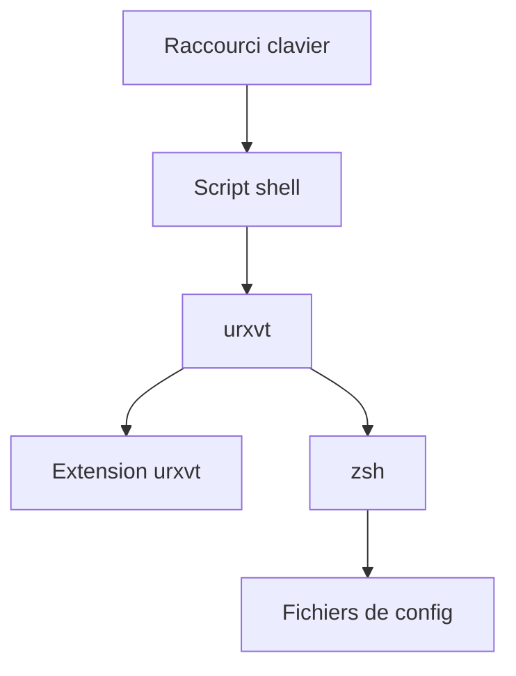

# Merovius/shellex

> dmenu-style application launcher, based on a zsh shell in a small urxvt terminal.

## The problem
Classic launchers offer little completion and flexibility; here you want the features of a real shell.

## What it actually does
Opens a minimal urxvt terminal that runs zsh and wraps each command (redirection, detaching, closing). It offers tab completion and screen selection. Configuration is done through shell fragments and X resources.

## How it is wired


## Trying it
```bash
git clone git://github.com/Merovius/shellex.git
cd shellex
make
make install
```

## Cost and gotchas
Free. Requires X11, urxvt and zsh; the README gives no version. Last push in 2018, license present but not identified.

## What it is not
Not a launcher for Wayland or macOS. The "dmenu-like" features and `.desktop` integration are announced but not implemented.

## Alternatives
No alternative named, apart from another launcher cited without a name in the demo video.

## For you
Ignore: an old Linux desktop tool with no follow-up, unrelated to data or MLOps.
