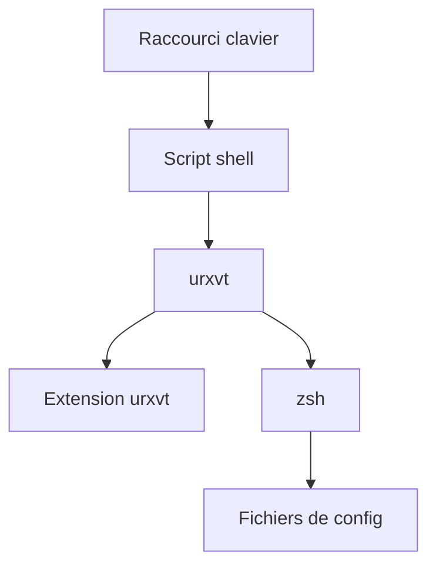

# Merovius/shellex

> Lanceur d'applications de type dmenu, fondé sur un shell zsh dans un petit terminal urxvt.

## Le problème
Les lanceurs classiques offrent peu de complétion et de souplesse ; ici on veut les fonctions d'un vrai shell.

## Ce que ça fait vraiment
Ouvre un terminal urxvt minimal qui lance zsh et enveloppe chaque commande (redirection, détachement, fermeture). Il offre la complétion par tabulation et le choix de l'écran. La configuration se fait par fragments shell et ressources X.

## Comment c'est branché


## Essayer
```bash
git clone git://github.com/Merovius/shellex.git
cd shellex
make
make install
```

## Coût et pièges
Gratuit. Nécessite X11, urxvt et zsh ; le README ne précise pas de version. Dernier push en 2018, licence présente mais non identifiée.

## Ce que ce n'est pas
Pas un lanceur pour Wayland ni macOS. Les fonctions « dmenu-like » et l'intégration `.desktop` sont annoncées mais non implémentées.

## Alternatives
Aucune alternative nommée, hormis un autre lanceur cité sans nom dans la vidéo de démonstration.

## Pour toi
À ignorer : outil de bureau Linux ancien et sans suite, sans rapport avec la data ou le MLOps.

