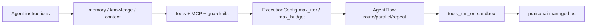

# MervinPraison/PraisonAI

> Python and YAML agent framework covering prompt, context, harness, loop and graph.

## The problem
Most agent frameworks cover one or two layers, and when the agent goes off the rails you do not know which level to look at.

## What it actually does
Organizes the agent into five named layers: prompt, context, harness, loop, graph — each with its own parameters (`instructions=`, `memory=`, `tools=`, `execution=`, `AgentFlow`).
Infinite loop detection by default: repeated identical calls and A→B→A→B oscillation.
`tools_run_on=` moves only the tools to a sandbox (docker, e2b, modal, daytona, flyio…), `run_on=` moves the whole agent.
The same graph can be expressed in YAML without a line of Python; JavaScript SDK available.

## How it is wired


## Trying it
```bash
pip install praisonaiagents
export OPENAI_API_KEY="your-api-key"
pip install "praisonai[claw]"
praisonai claw
praisonai agents.yaml
```

## Cost and gotchas
`OPENAI_API_KEY` required from the first example, `TAVILY_API_KEY` for the Claw dashboard. Managed sandboxes (e2b, modal, daytona, flyio) are billed third-party services. `max_budget` exists but you have to set it yourself.

## What it is not
Not a stable, well-scoped product: the surface is huge (more than 25 features, a dozen sub-packages), carried by one maintainer. The proposed installation goes through `curl | bash`, to be avoided. The README itself warns never to put `eval()` or `subprocess` in a tool.

## Alternatives
None named; the README points to the posts "The Five-Layer Agent Stack" and "Agent Harnesses vs Orbs" for the conceptual framing.

## For you
The five-layer split is a good mental model; as a production dependency, the surface and governance call for caution.
