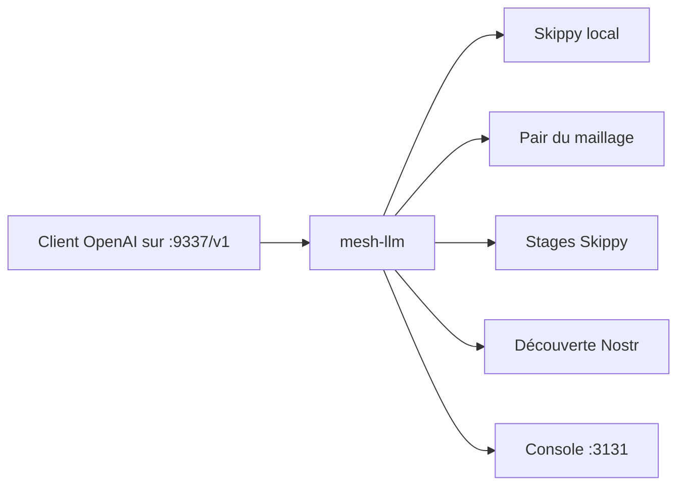

# Mesh-LLM/mesh-llm

> Pools the GPUs of several machines behind a single OpenAI-compatible API, for anyone hosting LLMs.

## The problem
A large model does not fit on a single machine, and splitting inference across several boxes by hand is painful.

## What it actually does
Launches a node that exposes `http://localhost:9337/v1`. Depending on the requested model, the request is served locally, routed to a peer or split into layer stages (Skippy). Traffic between nodes is encrypted over QUIC. Public meshes are discovered via Nostr, private ones by invitation token. A web console runs on port 3131. The `model: "mesh"` mode (experimental) queries all the models in the mesh.

## How it is wired
Simplified diagram based on the fiche, no diagram provided.


## Trying it
```bash
curl -fsSL https://raw.githubusercontent.com/Mesh-LLM/mesh-llm/main/install.sh | bash
mesh-llm setup
mesh-llm serve --auto
curl -s http://localhost:9337/v1/models | jq '.data[].id'
```

## Cost and gotchas
Free, but requires GPU and memory for the models, and a model download on first launch. `--auto` joins a public mesh: your requests may pass through unknown peers. Blackwell cards on native Windows are not covered.

## What it is not
Not a managed service nor a model: it is a tool you have to operate. The `--local-model-only` mode is a debugging mode, not the production path. The binary is not signed on Windows.

## Alternatives
The repository cites Exo in its documentation (EXO_COMPARISON.md) as a comparison: worth a look for a balanced comparison.

## For you
Worth watching: interesting for pooling GPUs in a lab or homelab, but young, with 174 open issues and a public mesh to handle with caution for sensitive data.
