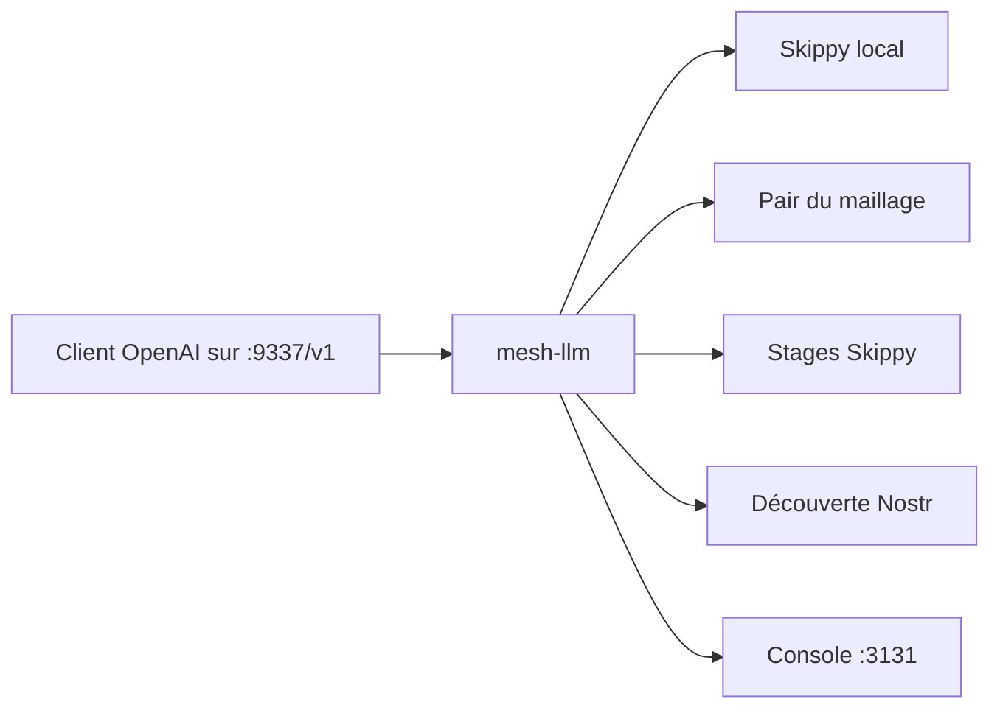

# Mesh-LLM/mesh-llm

> Met en commun les GPU de plusieurs machines derrière une seule API compatible OpenAI, pour qui héberge des LLM.

## Le problème
Un gros modèle ne tient pas sur une seule machine, et répartir l'inférence entre plusieurs boîtes à la main est pénible.

## Ce que ça fait vraiment
Lance un nœud qui expose `http://localhost:9337/v1`. Selon le modèle demandé, la requête est servie en local, routée vers un pair ou découpée en étages de couches (Skippy). Le trafic entre nœuds est chiffré en QUIC. Les maillages publics se découvrent via Nostr, les privés par jeton d'invitation. Une console web tourne sur le port 3131. Le mode `model: "mesh"` (expérimental) interroge tous les modèles du maillage.

## Comment c'est branché
Schéma simplifié d'après la fiche, sans diagramme fourni.


## Essayer
```bash
curl -fsSL https://raw.githubusercontent.com/Mesh-LLM/mesh-llm/main/install.sh | bash
mesh-llm setup
mesh-llm serve --auto
curl -s http://localhost:9337/v1/models | jq '.data[].id'
```

## Coût et pièges
Gratuit, mais demande GPU et mémoire pour les modèles, et un téléchargement de modèle au premier lancement. `--auto` rejoint un maillage public : tes requêtes peuvent passer par des pairs inconnus. Les cartes Blackwell sous Windows natif ne sont pas couvertes.

## Ce que ce n'est pas
Pas un service géré ni un modèle : c'est un outil à exploiter. Le mode `--local-model-only` est un mode de débogage, pas le chemin de production. La signature du binaire n'est pas faite sous Windows.

## Alternatives
Le dépôt cite Exo dans sa documentation (EXO_COMPARISON.md) comme comparaison : à regarder pour un comparatif équilibré.

## Pour toi
À surveiller : intéressant pour mutualiser des GPU en labo ou homelab, mais jeune, avec 174 issues ouvertes et un public mesh à manier avec prudence pour des données sensibles.

