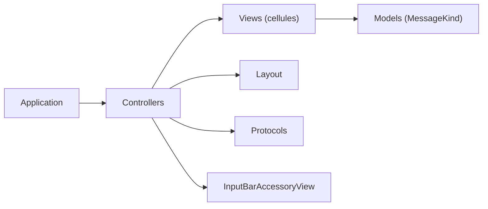

# MessageKit/MessageKit

> iOS library for customizable chat interfaces, a community replacement for JSQMessagesViewController.

## The problem
Writing an iOS messaging interface (bubbles, avatars, media) takes a long time.

## What it actually does
Provides `MessagesViewController`, cells for each message type (text, photo, video, location, audio, contact, link preview, custom), layout calculators and protocols (`MessagesDataSource`, display delegates). The input bar comes from InputBarAccessoryView. Requires iOS 14+ and Swift 6.

## How it is wired


## Trying it
Add the package through Swift Package Manager in Xcode with the URL:
```
https://github.com/MessageKit/MessageKit
```

## Cost and gotchas
Free. Older iOS/Swift versions are stuck on older versions of the package. Custom cells: the layout is entirely up to you.

## What it is not
Not a messaging backend: display only.

## Alternatives
None named in the README (JSQMessagesViewController as inspiration).

## For you
Ignore: iOS UI library, unrelated to data/AI/MLOps.
