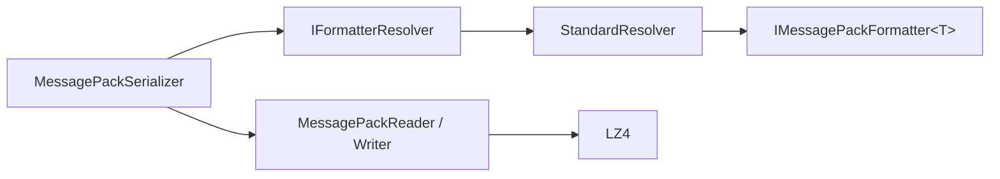

# MessagePack-CSharp/MessagePack-CSharp

> A MessagePack binary serializer for C#, with LZ4 compression, for .NET and Unity developers.

## The problem
JSON serialization is slow and bulky for games, microservices and caches.

## What it actually does
You annotate classes with `[MessagePackObject]` and `[Key]`, then `MessagePackSerializer.Serialize/Deserialize` converts to bytes. It handles unions, immutable objects, record types, dynamic deserialization, Typeless mode and custom resolvers. A Roslyn analyzer and a source generator help, with AOT compatibility.

## How it is wired


## Trying it
```bash
Install-Package MessagePack
```
```csharp
byte[] bytes = MessagePackSerializer.Serialize(mc);
MyClass mc2 = MessagePackSerializer.Deserialize<MyClass>(bytes);
```

## Cost and gotchas
Free, via NuGet. Deserializing untrusted data can execute code: use `MessagePackSecurity.UntrustedData` and avoid Typeless. License present but not identified by GitHub.

## What it is not
Not a multi-language library: this is the C# version. The `UntrustedData` mode is not full protection.

## Alternatives
- MsgPack-Cli, protobuf, ZeroFormatter: compared in the README.

## For you
Ignore: reserved for the C#/.NET ecosystem, outside the usual data and AI stack.
