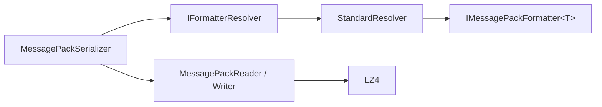

# MessagePack-CSharp/MessagePack-CSharp

> Un sérialiseur binaire MessagePack pour C#, avec compression LZ4, pour les développeurs .NET et Unity.

## Le problème
La sérialisation JSON est lente et volumineuse pour jeux, microservices et caches.

## Ce que ça fait vraiment
On annote des classes avec `[MessagePackObject]` et `[Key]`, puis `MessagePackSerializer.Serialize/Deserialize` convertit en octets. Il gère unions, objets immuables, types records, désérialisation dynamique, mode Typeless et résolveurs personnalisés. Un analyseur Roslyn et un générateur source aident, avec compatibilité AOT.

## Comment c'est branché


## Essayer
```bash
Install-Package MessagePack
```
```csharp
byte[] bytes = MessagePackSerializer.Serialize(mc);
MyClass mc2 = MessagePackSerializer.Deserialize<MyClass>(bytes);
```

## Coût et pièges
Gratuit, via NuGet. Désérialiser des données non fiables peut exécuter du code : utiliser `MessagePackSecurity.UntrustedData` et éviter Typeless. Licence présente mais non identifiée par GitHub.

## Ce que ce n'est pas
Pas une bibliothèque multi-langage : c'est la version C#. Le mode `UntrustedData` n'est pas une protection totale.

## Alternatives
- MsgPack-Cli, protobuf, ZeroFormatter : comparés dans le README.

## Pour toi
À ignorer : réservé à l'écosystème C#/.NET, hors de la pile data et IA habituelle.

