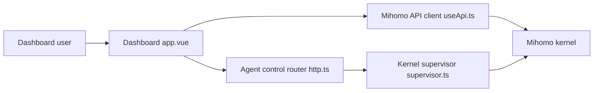

# MetaCubeX/metacubexd

> Web dashboard, desktop app and all-in-one server to control the Mihomo (Clash Meta) proxy.

## The problem
Mihomo is configured in YAML and driven through an API: without an interface, following traffic, connections and rules is painful.

## What it actually does
The dashboard shows live traffic, proxy groups with latency tests, connections, rules and logs. It comes in three forms: a hosted panel pointing to a remote Mihomo, a desktop application with an embedded kernel, and an all-in-one Docker image. The last two add profile management and a config editor. TUN mode installs a privileged helper.

## How it is wired


## Trying it
```shell
docker run -d --name metacubexd -p 8080:80 ghcr.io/metacubex/metacubexd:latest
# Ouvrir http://localhost:8080
```

## Cost and gotchas
Free. The desktop installers are not signed (the README says so). The control token is injected into the browser: it does not protect the dashboard, so a trusted network is required. Binding the controller to `0.0.0.0` exposes it on all interfaces.

## What it is not
Not a proxy: a Mihomo kernel is needed, provided only in the desktop and server variants. Not a security tool.

## Alternatives
The README names no alternative.

## For you
Ignore: useful only if you administer a Mihomo proxy, unrelated to data or AI work.
