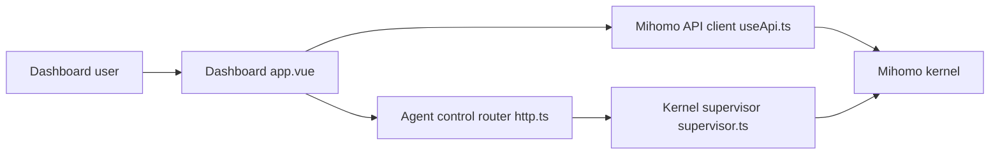

# MetaCubeX/metacubexd

> Tableau de bord web, appli de bureau et serveur tout-en-un pour piloter le proxy Mihomo (Clash Meta).

## Le problème
Mihomo se configure en YAML et se pilote par API : sans interface, suivre le trafic, les connexions et les règles est pénible.

## Ce que ça fait vraiment
Le tableau de bord affiche le trafic en direct, les groupes de proxys avec test de latence, les connexions, les règles et les journaux. Il existe en trois formes : panneau hébergé pointant vers un Mihomo distant, application de bureau avec noyau embarqué, image Docker tout-en-un. Les deux dernières ajoutent gestion de profils et éditeur de config. Le mode TUN installe un helper privilégié.

## Comment c'est branché


## Essayer
```shell
docker run -d --name metacubexd -p 8080:80 ghcr.io/metacubex/metacubexd:latest
# Ouvrir http://localhost:8080
```

## Coût et pièges
Gratuit. Les installeurs de bureau ne sont pas signés (le README le dit). Le token de contrôle est injecté dans le navigateur : il ne protège pas le tableau de bord, il faut un réseau de confiance. Lier le contrôleur à `0.0.0.0` l'expose sur toutes les interfaces.

## Ce que ce n'est pas
Pas un proxy : il faut un noyau Mihomo, fourni seulement dans les variantes bureau et serveur. Pas un outil de sécurité.

## Alternatives
Le README ne nomme pas d'alternative.

## Pour toi
Ignorer : utile seulement si tu administres un proxy Mihomo, sans lien avec un travail data ou IA.

