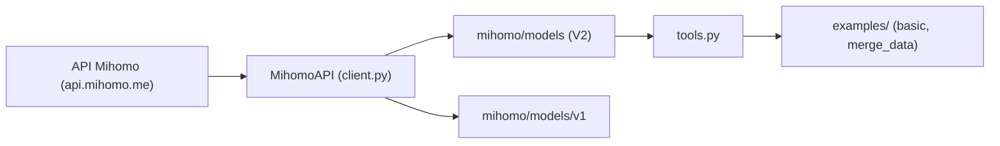

# MetaCubeX/mihomo

> Typed pydantic models for Honkai: Star Rail data from the Mihomo API, aimed at game bot developers.

## The problem
Honkai: Star Rail profile data returned by the Mihomo API is raw JSON, with no typing or editor completion.

## What it actually does
The README provided describes an asynchronous client (MihomoAPI) that queries api.mihomo.me/sr_info_parsed/{UID} and parses the response into pydantic models, in two formats (V1 and V2). A tools module provides remove_duplicate_character and merge_character_data. Data is saved as pickle or JSON. Anomaly: this text corresponds to the KT-Yeh/mihomo repository (installation from KT-Yeh), not to a MetaCubeX sheet.

## How it is wired


## Trying it
```bash
pip install -U git+https://github.com/KT-Yeh/mihomo.git
```

## Cost and gotchas
Free, but depends on an unofficial third-party API whose availability is not guaranteed. Python asyncio is required for the examples.

## What it is not
It is not, according to this README, a proxy or network tool. The content cannot be tied with certainty to the MetaCubeX/mihomo repository described by the catalog (34,184 stars): to be rechecked at the source.

## Alternatives
No alternative cited in the README.

## For you
Ignore: the text read concerns a video game, outside data/AI/MLOps, and does not match the cataloged repository, so nothing reliable can be drawn from it.
