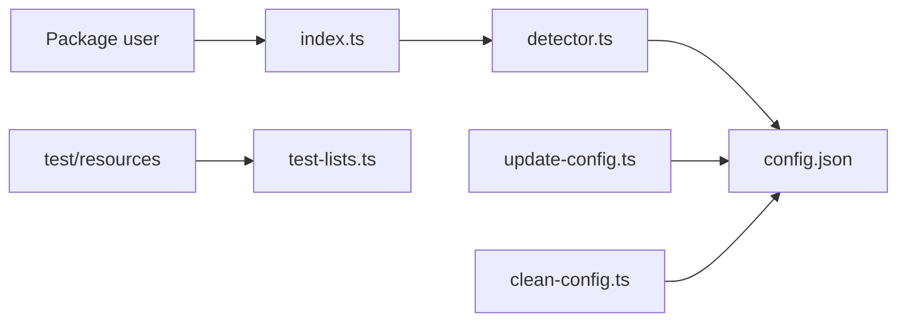

# MetaMask/eth-phishing-detect

> List of malicious domains targeting Web3 users, with maintenance tools, for wallet and extension developers.

## The problem
Sites that imitate crypto services and collect signing keys trap users; a shared, maintained list is needed to block them.

## What it actually does
- Provides `src/config.json`: blocklists, allowlists and "fuzzy" lists of domains.
- A detector loads this configuration and checks a supplied domain (the README says the detector has been moved elsewhere).
- CLIs add or remove domains (`yarn add:blocklist`, `yarn remove:allowlist`...) and clean up the file.
- Lists of legitimate domains in `test/resources` serve as a safeguard against false positives.

## How it is wired


## Trying it
```bash
yarn add:blocklist crypto-phishing-site.tld
yarn add:allowlist legitimate-site.tld
yarn remove:blocklist legitimate-site.tld
yarn update:lists
git log -S "example.com" -- src/config.json
```

## Cost and gotchas
Free. `yarn update:lists` requires a CoinMarketCap Pro API key. Blocking a domain already present in the safeguard lists requires a workaround in `test/test-lists.ts`.

## What it is not
It is not a standalone detector: the detection code is elsewhere. It is not a guarantee: the list reacts to reports. The license is present but not identified by GitHub, to be checked before reuse.

## Alternatives
The README only cites ChainPatrol's third-party search tool, to find out why a domain is blocked.

## For you
Worth watching: useful if you are building a Web3 extension or front end to protect, with no direct link to data/MLOps work; check the license first.
