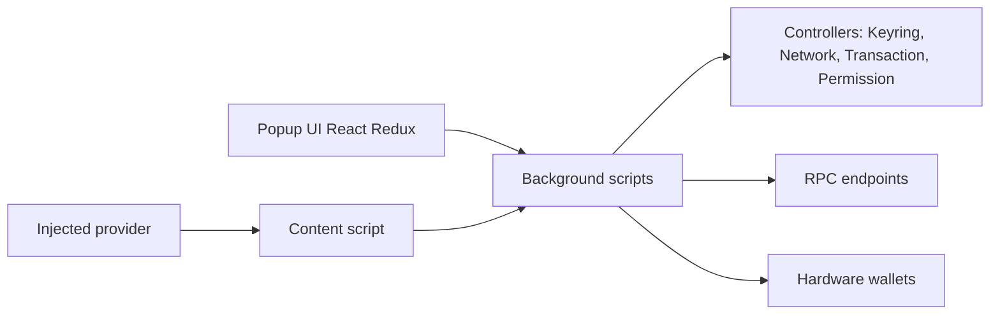

# MetaMask/metamask-extension

> Source code of the MetaMask browser extension, a wallet and gateway to blockchain applications, for developers who build it.

## The problem
Interacting with decentralized applications from a browser requires a wallet that holds the keys and signs transactions.

## What it actually does
This repository's README is mostly a contribution guide: local build with Yarn, unit and E2E tests (Selenium then Playwright), remote feature flags, LavaMoat policy updates. The architecture described from the code separates the React/Redux interface, the background scripts with their controllers, and the provider injected into pages. One section describes `yarn skills`, which synchronizes skills for agents locally (Cursor, Claude Code, Codex).

## How it is wired


## Trying it
```bash
corepack enable
cp .metamaskrc{.dist,}
yarn install
yarn dist
yarn start
yarn test:unit
```
You must first replace `INFURA_PROJECT_ID` with your own key in `.metamaskrc`.

## Cost and gotchas
Node 24, a free Infura key, Yarn via Corepack. GitHub Codespaces is billed beyond the free quota. The config provides for Segment (MetaMetrics) and Sentry keys: telemetry exists in the product.

## What it is not
It is not a user guide: to use it, the README points to the official site. Nor is it a library reusable outside the browser.

## Alternatives
No alternative named in the README.

## For you
Ignore: it is the code of a crypto wallet, outside data/AI work; read it only for how the team handles flags, E2E and dependency policy.
