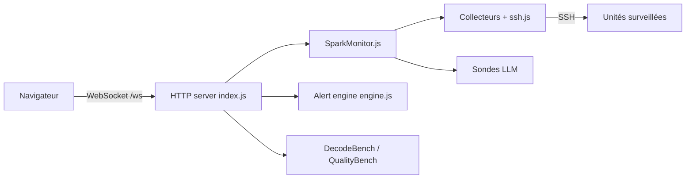

# MiaAI-Lab/sparkDash

> Real-time web dashboard to monitor GPU, memory and local LLMs on NVIDIA DGX Spark machines.

## The problem
Supervising several DGX Sparks (or GPU hosts) means opening SSH terminals and running `nvidia-smi` by hand, with no overview and no history.

## What it actually does
An Express server polls each unit (sysfs/proc locally, SSH remotely) and pushes the metrics over WebSocket to a React SPA. It detects the LLM engine (llama.cpp, vLLM, SGLang, Ollama...), measures tok/s, runs benchmarks (decode, prefill, quality), computes energy and alerts (ntfy, Discord, Slack, webhook). Optional modules: VulnHunter, REA, ComfyUI, Prometheus export.

## How it is wired


## Trying it
```bash
git clone https://github.com/MiaAI-Lab/sparkDash.git
cd sparkDash
docker compose up --build -d
# puis http://127.0.0.1:5555
```

## Cost and gotchas
Free. The container is privileged, targets arm64 (x86 build untested). Without `SPARKDASH_TOKEN`, a LAN bind is open: anyone can change the settings and shut down the units.

## What it is not
Not a general-purpose monitoring tool: designed for DGX Spark first. Energy values are estimates, not wattmeter measurements. It installs no LLM engine or model.

## Alternatives
- Prometheus/Grafana: sparkDash exposes `/metrics`; preferable if you already have that stack.
- Glance: a community widget displays sparkDash metrics in an existing dashboard.

## For you
Worth watching: very useful if you operate DGX Sparks, but outside that hardware (arm64, GB10) the interest drops; without a Spark, Prometheus/Grafana is enough.
