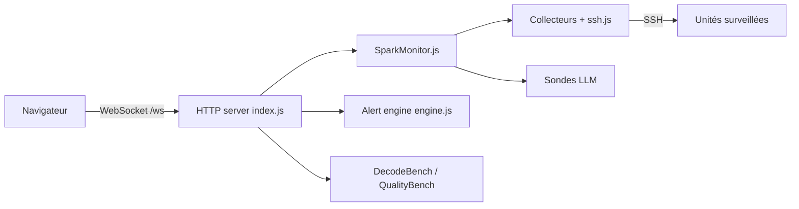

# MiaAI-Lab/sparkDash

> Tableau de bord web temps réel pour suivre GPU, mémoire et LLM locaux de machines NVIDIA DGX Spark.

## Le problème
Superviser plusieurs DGX Spark (ou hôtes GPU) oblige à ouvrir des terminaux SSH et à lancer `nvidia-smi` à la main, sans vue d'ensemble ni historique.

## Ce que ça fait vraiment
Un serveur Express interroge chaque unité (sysfs/proc en local, SSH à distance) et pousse les métriques par WebSocket vers une SPA React. Il détecte le moteur LLM (llama.cpp, vLLM, SGLang, Ollama…), mesure tok/s, lance des benchmarks (decode, prefill, qualité), calcule énergie et alertes (ntfy, Discord, Slack, webhook). Modules optionnels : VulnHunter, REA, ComfyUI, export Prometheus.

## Comment c'est branché


## Essayer
```bash
git clone https://github.com/MiaAI-Lab/sparkDash.git
cd sparkDash
docker compose up --build -d
# puis http://127.0.0.1:5555
```

## Coût et pièges
Gratuit. Le conteneur est privilégié, cible arm64 (build x86 non testé). Sans `SPARKDASH_TOKEN`, un bind LAN est ouvert : tout le monde peut changer les réglages et éteindre les unités.

## Ce que ce n'est pas
Pas un outil généraliste de monitoring : pensé pour DGX Spark d'abord. Les valeurs d'énergie sont des estimations, pas des mesures au wattmètre. Il n'installe aucun moteur LLM ni modèle.

## Alternatives
- Prometheus/Grafana : sparkDash expose `/metrics` ; à préférer si tu as déjà cette pile.
- Glance : un widget communautaire affiche les métriques sparkDash dans un tableau de bord existant.

## Pour toi
À surveiller : très utile si tu opères des DGX Spark, mais hors de ce matériel (arm64, GB10) l'intérêt chute ; sans Spark, Prometheus/Grafana suffit.

