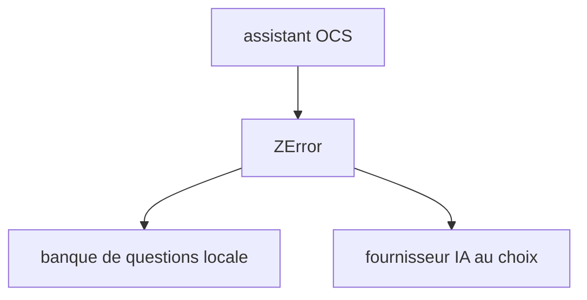

# Miaozeqiu/ZError

> Windows application for a local AI question bank, for the OCS course assistant.

## The problem
The OCS assistant requires a local question bank to query.

## What it actually does
Configures the bank for OCS, lets you choose AI providers and models, and manages questions locally with caching, editing and folders. Built with Tauri.

## How it is wired
Simplified diagram based on the sheet, no diagram provided.

## Trying it
Download the latest version from the official site, run the installer then the software (Windows 10/11).

## Cost and gotchas
An AI provider must be plugged in (key likely, not specified). Short README in Chinese, insufficient material.

## What it is not
Not a documented application: the README details neither how it works nor its limits.

## Alternatives
No alternative named.

## For you
Ignore: niche tool for the OCS course assistant, too little documentation.
