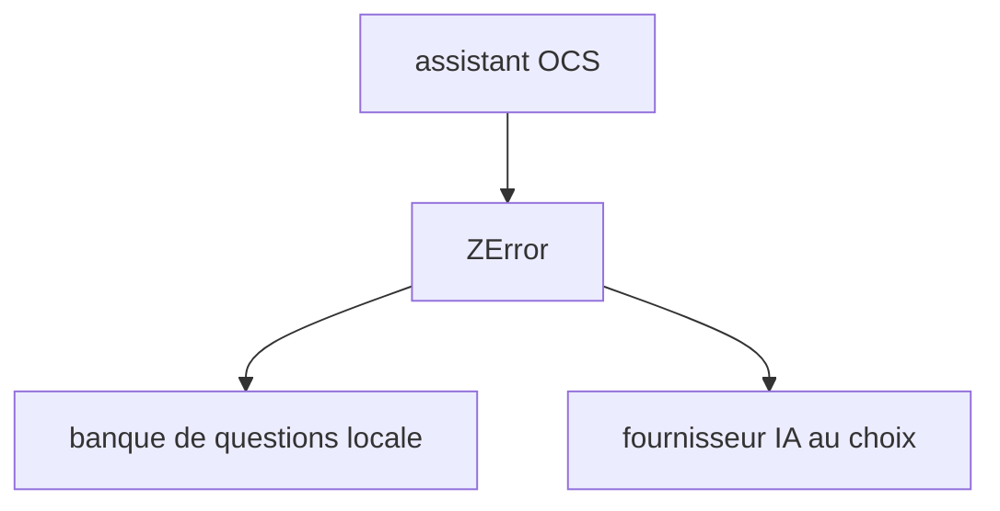

# Miaozeqiu/ZError

> Application Windows de banque de questions IA locale, pour l'assistant de cours OCS.

## Le problème
L'assistant OCS demande une banque de questions locale à interroger.

## Ce que ça fait vraiment
Configure la banque pour OCS, permet de choisir fournisseurs et modèles d'IA et gère localement les questions avec cache, édition et dossiers. Développée avec Tauri.

## Comment c'est branché
Schéma simplifié d'après la fiche, sans diagramme fourni.

## Essayer
Télécharger la dernière version sur le site officiel, lancer l'installeur puis le logiciel (Windows 10/11).

## Coût et pièges
Fournisseur IA à brancher (clé probable, non précisée). README court en chinois, matière insuffisante.

## Ce que ce n'est pas
Pas une application documentée : le README ne détaille ni fonctionnement ni limites.

## Alternatives
Aucune alternative nommée.

## Pour toi
À ignorer : outil de niche pour l'assistant de cours OCS, trop peu documenté.

