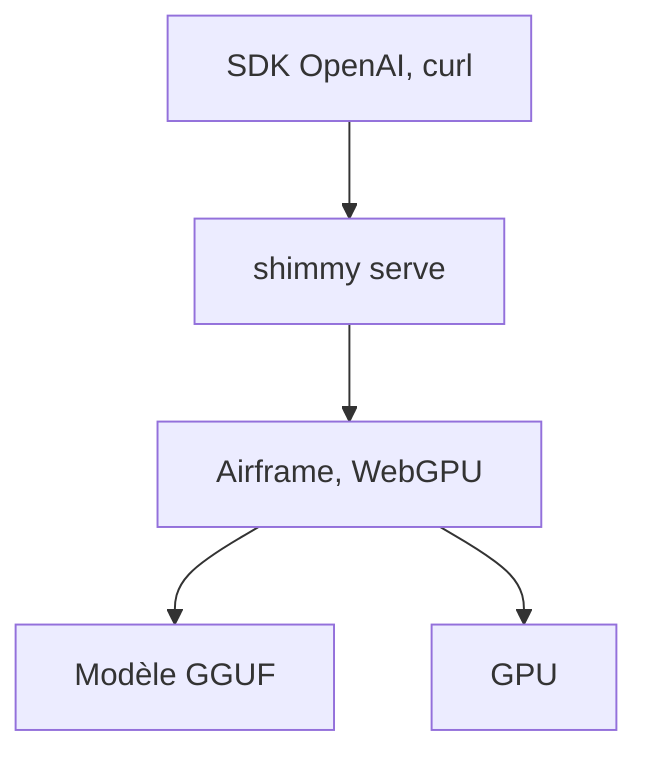

# Michael-A-Kuykendall/shimmy

> Local OpenAI-compatible inference server for GGUF models, in a single Rust binary.

## The problem
Running a local model behind the OpenAI API often requires Python or a C++ toolchain.

## What it actually does
A server for GGUF models that exposes chat, completions, streaming and the model list. It relies on Airframe, a transformer engine in Rust on WebGPU (WGSL), which aims at deterministic outputs. The README claims 26 certified models, an INT4 KV cache and YaRN context extension.

## How it is wired

Simplified diagram based on the fiche, no diagram provided.

## Trying it
```bash
cargo install shimmy --locked
shimmy serve --model-path /absolute/path/to/model.gguf --bind 127.0.0.1:11435
shimmy list --short
```

## Cost and gotchas
Free, with a GPU. Network access requires SHIMMY_API_KEY and, for browsers, SHIMMY_ALLOWED_ORIGINS. The llama.cpp, MLX and HuggingFace backends were removed in v2.0.

## What it is not
Not a proven replacement for Ollama: the comparison table comes from the author, measured on a single GPU with TinyLlama. MoE support is only a roadmap item. A contact is given for billing companies.

## Alternatives
Ollama, cited in the comparison: broader ecosystem, slower startup according to the author.

## For you
Worth watching: interesting for serving a GGUF locally without Python, but young, run by a single person and little measured outside the author.
