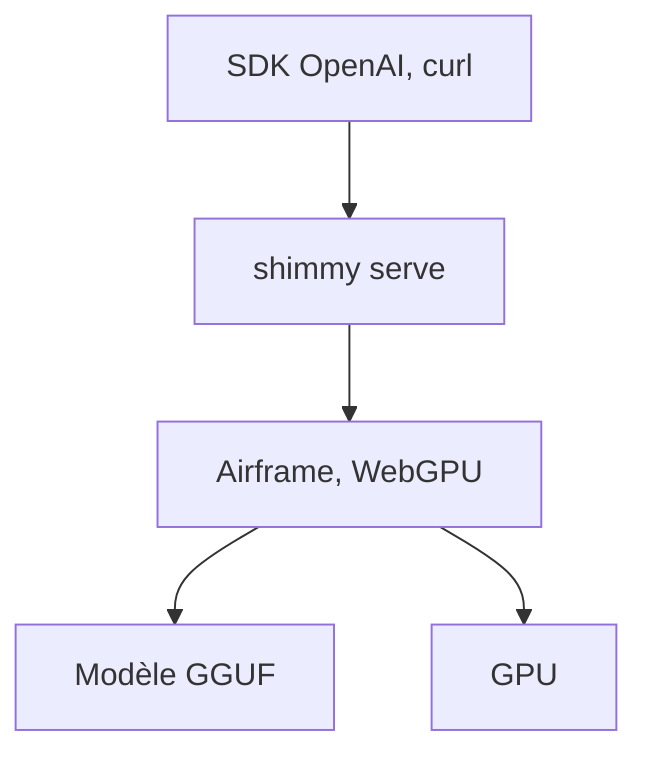

# Michael-A-Kuykendall/shimmy

> Serveur d'inférence local compatible OpenAI pour modèles GGUF, en un seul binaire Rust.

## Le problème
Faire tourner un modèle local derrière l'API OpenAI exige souvent Python ou une chaîne C++.

## Ce que ça fait vraiment
Serveur pour modèles GGUF qui expose chat, complétions, streaming et liste des modèles. Il repose sur Airframe, un moteur transformer en Rust sur WebGPU (WGSL), qui vise des sorties déterministes. Le README annonce 26 modèles certifiés, un cache KV INT4 et une extension de contexte YaRN.

## Comment c'est branché

Schéma simplifié d'après la fiche, sans diagramme fourni.

## Essayer
```bash
cargo install shimmy --locked
shimmy serve --model-path /absolute/path/to/model.gguf --bind 127.0.0.1:11435
shimmy list --short
```

## Coût et pièges
Gratuit, avec GPU. L'accès réseau exige SHIMMY_API_KEY et, pour les navigateurs, SHIMMY_ALLOWED_ORIGINS. Les backends llama.cpp, MLX et HuggingFace ont été retirés en v2.0.

## Ce que ce n'est pas
Pas un remplaçant éprouvé d'Ollama : le tableau comparatif vient de l'auteur, mesuré sur un seul GPU avec TinyLlama. Le support MoE n'est qu'une feuille de route. Un contact est donné pour facturer les entreprises.

## Alternatives
Ollama, cité en comparaison : écosystème plus large, démarrage plus lent selon l'auteur.

## Pour toi
À surveiller : intéressant pour servir un GGUF en local sans Python, mais jeune, tenu par une seule personne et peu mesuré hors de l'auteur.

