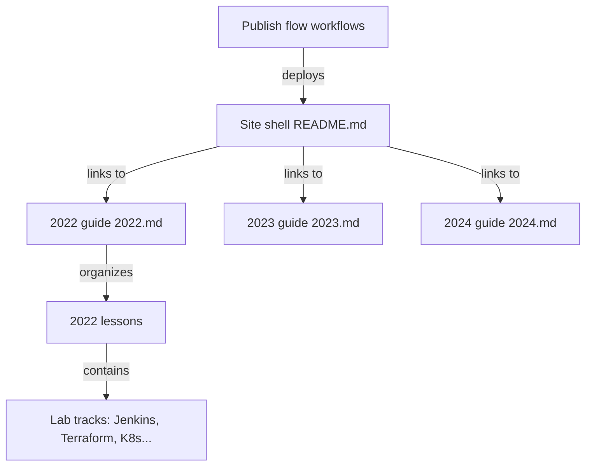

# MichaelCade/90DaysOfDevOps

> Community-driven 90-day path to learn DevOps, with translations and sample labs.

## The problem
Approaching DevOps without a guiding thread: many tools, scattered free resources.

## What it actually does
- Day-by-day Markdown lessons (2022, 2023, 2024), plus DevSecOps and community sessions.
- Standalone labs: Jenkins, Terraform, Ansible/Vagrant, Docker Compose, Kubernetes, Elastic stack, Netmiko network scripts, Go exercises.
- Translated copies in several languages (including fr).
- GitHub Pages-style static site, published by workflows.

## How it is wired

## Trying it
No documented command: you read the content on the site or in the repository.

## Cost and gotchas
Free, open-source software. A license is present but not identified by GitHub: check before reusing. Last push on 2026-06-24: part of the content is dated (2022-2024).

## What it is not
Not an exhaustive DevOps course (the author says so), nor an application. The labs are isolated exercises, not composed together.

## Alternatives
The README names no alternative.

## For you
Worth watching: useful to fill gaps in DevOps/MLOps basics (CI/CD, K8s, IaC), best read by picking the relevant days rather than following all 90.
