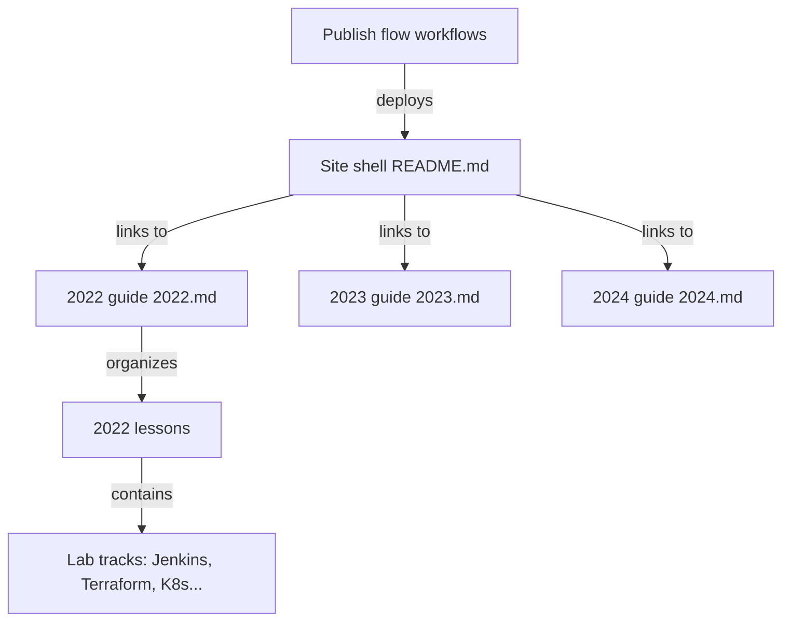

# MichaelCade/90DaysOfDevOps

> Parcours communautaire de 90 jours pour apprendre DevOps, avec traductions et labs d'exemple.

## Le problème
Aborder DevOps sans fil conducteur : outils nombreux, ressources gratuites éparses.

## Ce que ça fait vraiment
- Leçons Markdown jour par jour (2022, 2023, 2024), plus DevSecOps et sessions communautaires.
- Labs autonomes : Jenkins, Terraform, Ansible/Vagrant, Docker Compose, Kubernetes, stack Elastic, scripts réseau Netmiko, exercices Go.
- Copies traduites en plusieurs langues (dont fr).
- Site statique de type GitHub Pages, publié par workflows.

## Comment c'est branché

## Essayer
Aucune commande documentée : on lit le contenu sur le site ou dans le dépôt.

## Coût et pièges
Gratuit, logiciels libres. Licence présente mais non identifiée par GitHub : à vérifier avant réutilisation. Dernier push le 2026-06-24 : contenu en partie daté (2022-2024).

## Ce que ce n'est pas
Pas un cours exhaustif sur DevOps (l'auteur le dit), ni une application. Les labs sont des exercices isolés, non composés.

## Alternatives
Le README ne nomme aucune alternative.

## Pour toi
À surveiller : utile pour combler des bases DevOps/MLOps (CI/CD, K8s, IaC), à lire en piochant les jours utiles plutôt qu'en suivant les 90.

