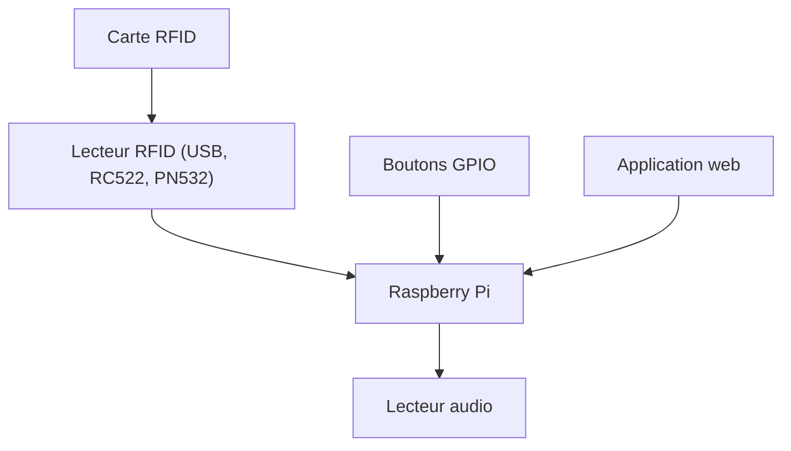

# MiczFlor/RPi-Jukebox-RFID

> An audio jukebox for Raspberry Pi triggered by RFID cards, aimed at tinkerers and families.

## The problem
A young child cannot operate an on-screen music player: they need a simple object to handle.

## What it actually does
The Phoniebox plays audio files, playlists, podcasts, web streams and Spotify when an RFID card is brought near. It also handles GPIO buttons, a web app, WiFi, a fallback access point and MQTT. Version 2 is going into maintenance, version 3 in Python becomes the reference.

## How it is wired
Simplified diagram based on the sheet, no diagram provided.



## Trying it
```bash
# Aucune commande dans le README : voir le script d'installation en une ligne
# de la version 2 dans le wiki du projet.
```

## Cost and gotchas
You need a Raspberry Pi, an RFID reader, cards and speakers. The Spotify integration requires an account, and version 2 no longer receives new features.

## What it is not
It is not software alone: it is a hardware project. The documentation is mostly a wiki, and version 3 is still in transition.

## Alternatives
No alternative named in the README for the same use; it cites commercial products (tonies, Hörbert) as inspirations.

## For you
Ignore for a data / AI / MLOps profile: it is a home DIY project unrelated to your field.
