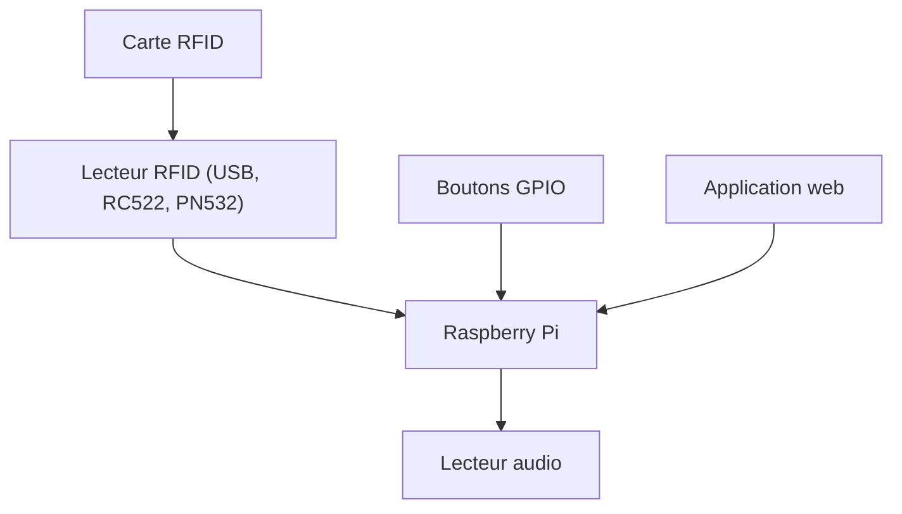

# MiczFlor/RPi-Jukebox-RFID

> Juke-box audio pour Raspberry Pi déclenché par cartes RFID, destiné aux bricoleurs et aux familles.

## Le problème
Un jeune enfant ne sait pas piloter un lecteur de musique sur écran : il lui faut un objet simple à manipuler.

## Ce que ça fait vraiment
La Phoniebox lit fichiers audio, listes de lecture, podcasts, flux web et Spotify quand on approche une carte RFID. Elle gère aussi des boutons GPIO, une application web, le WiFi, un point d'accès de secours et MQTT. La version 2 passe en maintenance, la version 3 en Python devient la référence.

## Comment c'est branché
Schéma simplifié d'après la fiche, sans diagramme fourni.



## Essayer
```bash
# Aucune commande dans le README : voir le script d'installation en une ligne
# de la version 2 dans le wiki du projet.
```

## Coût et pièges
Il faut un Raspberry Pi, un lecteur RFID, des cartes et des enceintes. L'intégration Spotify demande un compte, et la version 2 ne reçoit plus de nouveautés.

## Ce que ce n'est pas
Ce n'est pas un logiciel seul : c'est un projet matériel. La documentation est surtout un wiki, et la version 3 est encore en transition.

## Alternatives
Aucune alternative nommée dans le README pour le même usage ; il cite des produits commerciaux (tonies, Hörbert) comme inspirations.

## Pour toi
À ignorer pour un profil data / IA / MLOps : c'est un projet de bricolage domestique sans lien avec ton métier.

