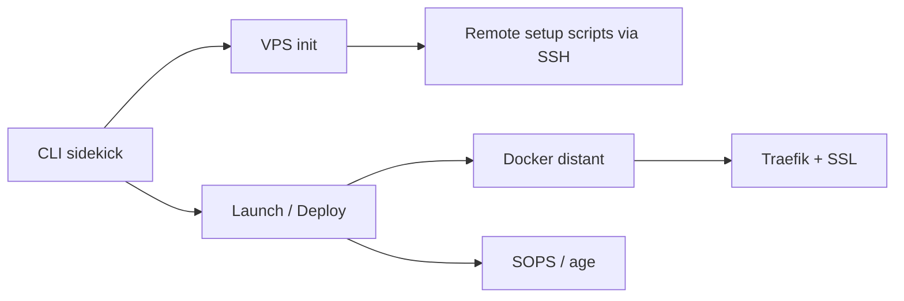

# MightyMoud/sidekick

> Command-line tool that prepares a VPS and deploys Docker applications on it with zero downtime.

## The problem
Hosting personal projects on a VPS means manually configuring Docker, SSL, secrets and zero-downtime deployments.

## What it actually does
`sidekick init` configures an Ubuntu VPS (dedicated user, root disabled, Docker, Traefik, SSL, sops and age). `sidekick launch` builds the image locally, transfers it, encrypts the `.env` with sops and starts the application behind Traefik. `sidekick deploy` publishes a new version without downtime; `deploy preview` creates an environment tied to the commit.

## How it is wired


## Trying it
```bash
brew install sidekick
sidekick init
sidekick launch
sidekick deploy
sidekick deploy preview
```

## Cost and gotchas
An Ubuntu VPS (the README quotes about $8/month) and an SSH key. Homebrew is required locally, also used to install sops. Last push on 2026-02-03.

## What it is not
Not a multi-node orchestrator; the README mentions high availability and load balancing, but the documentation read stays on a single VPS. GPL-3.0 license.

## Alternatives
fly.io and Kamal (cited as inspiration).

## For you
Worth watching: handy for a demo or a small model service on a VPS, without the guarantees of a managed platform.
