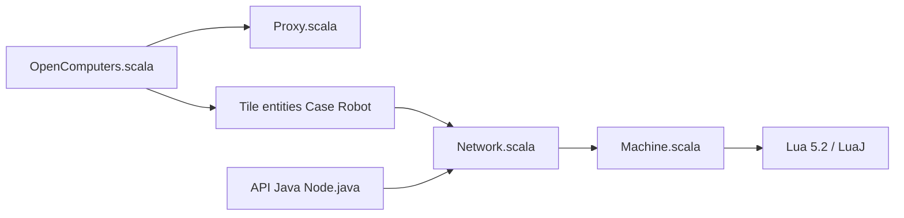

# MightyPirates/OpenComputers

> Minecraft mod that adds programmable computers and robots in Lua 5.2, for players and modders.

## The problem
Programming persistent machines and robots inside Minecraft.

## What it actually does
Forge mod for Minecraft 1.7.10, written mostly in Scala, that adds cases, robots, drones, screens and component networks. A virtual machine runs Lua 5.2 (native JNLua or LuaJ) with the OpenOS system. A Java API lets other mods add drivers. Repository archived.

## How it is wired


## Trying it
```bash
gradlew setupDecompWorkspace
gradlew idea
```

## Cost and gotchas
Free. Archived repository, old Minecraft version (1.7.10). The cited Maven repository uses `http://`.

## What it is not
Not a general development tool. License present but not identified by GitHub.

## Alternatives
No alternative named in the README (CC "ComputerCraft" appears there only as an optional integration).

## For you
Ignore: an archived game mod, unrelated to data or AI.
