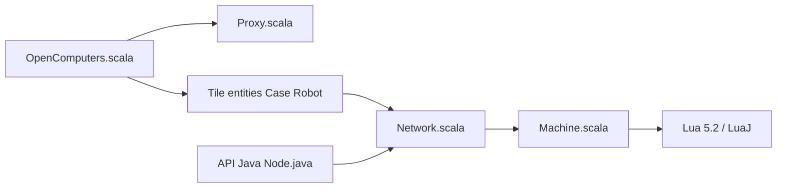

# MightyPirates/OpenComputers

> Mod Minecraft qui ajoute ordinateurs et robots programmables en Lua 5.2, pour joueurs et moddeurs.

## Le problème
Programmer des machines et robots persistants à l'intérieur de Minecraft.

## Ce que ça fait vraiment
Mod Forge pour Minecraft 1.7.10, écrit surtout en Scala, qui ajoute cases, robots, drones, écrans et réseaux de composants. Une machine virtuelle exécute du Lua 5.2 (JNLua natif ou LuaJ) avec le système OpenOS. Une API Java permet aux autres mods d'ajouter des drivers. Dépôt archivé.

## Comment c'est branché


## Essayer
```bash
gradlew setupDecompWorkspace
gradlew idea
```

## Coût et pièges
Gratuit. Dépôt archivé, version Minecraft ancienne (1.7.10). Le dépôt Maven cité est en `http://`.

## Ce que ce n'est pas
Pas un outil de développement général. Licence présente mais non identifiée par GitHub.

## Alternatives
Aucune alternative nommée dans le README (CC « ComputerCraft » n'y est qu'une intégration optionnelle).

## Pour toi
À ignorer : mod de jeu archivé, sans rapport avec la data ou l'IA.

