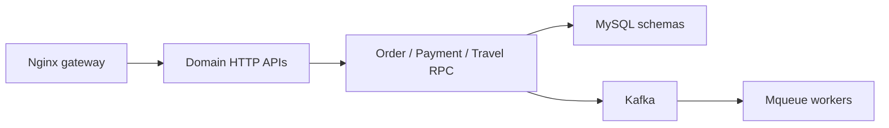

# Mikaelemmmm/go-zero-looklook

> Example Go microservices project with go-zero, on a lodging-booking theme.

## The problem
Beginners in go-zero lacked a complete example project.

## What it actually does
Five domains (users, travel, orders, payments, task queue) in HTTP API plus gRPC RPC, with Nginx as gateway. WeChat payment, Kafka via go-queue, deferred tasks with asynq/Redis, Filebeat logs, go-stash then Elasticsearch, Prometheus, Jaeger. Documented deployment with GitLab, Jenkins, Harbor and Kubernetes. DTM is planned but absent from the code.

## How it is wired

## Trying it
The README gives no command; the documentation is in `doc/english`, and Docker Compose is recommended for development.

## Cost and gotchas
Very wide stack (Kafka, Elasticsearch, Jenkins, Harbor). Last push in January 2025, more than a year ago. The English README is a rough translation.

## What it is not
Not a library: an educational example. No link with data or AI.

## Alternatives
- go-zero, the framework it demonstrates.

## For you
Ignore: Go microservices example unrelated to your profile, and barely active for over a year.
