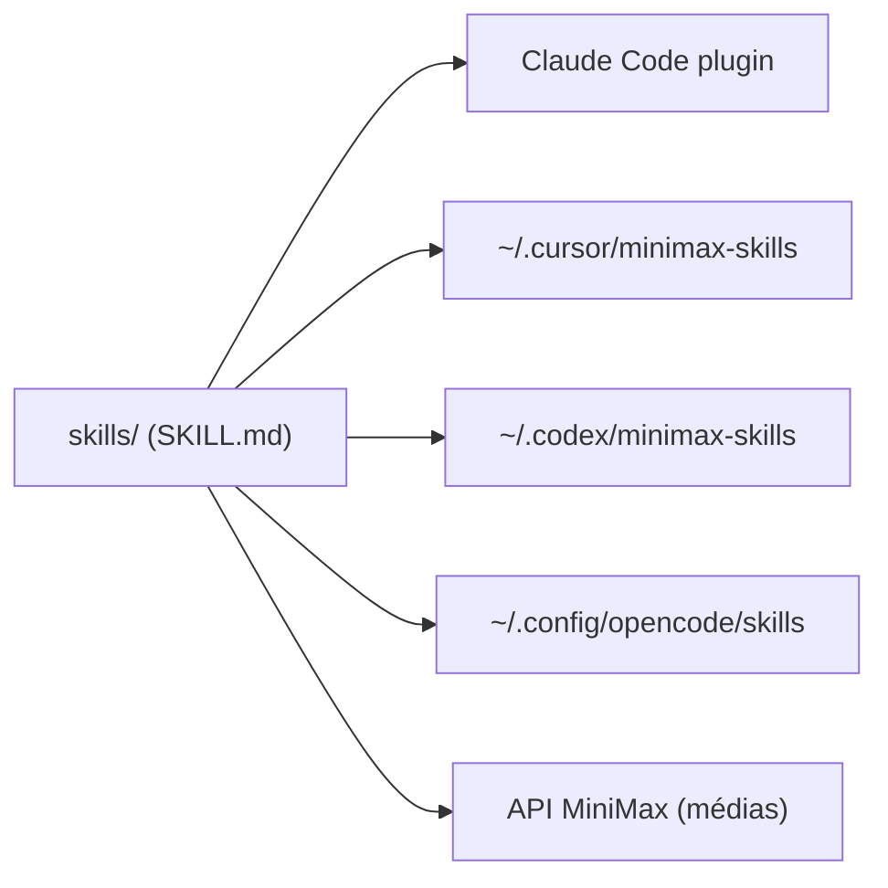

# MiniMax-AI/skills

> Development skills (front, back, mobile, shaders, documents) for coding agents, some of which call the MiniMax API.

## The problem
Coding agents produce mediocre interfaces and documents without structured guidance per domain.

## What it actually does
A set of skills: frontend-dev, fullstack-dev, Android, iOS, Flutter, React Native, shader-dev, PDF, PPTX, XLSX and DOCX generation. Others (music, video, TTS, GIF, vision) go through the MiniMax API. Installation via the Claude Code marketplace, clone for Cursor, Codex and OpenCode. The README declares itself beta.

## How it is wired


## Trying it
```bash
claude plugin marketplace add https://github.com/MiniMax-AI/skills
claude plugin install minimax-skills
```

## Cost and gotchas
The media skills require a MiniMax key, paid by usage. Formats and configs "may change without notice" (beta). Last push on 2026-04-18.

## What it is not
Not a single tool but an assortment: the document skills (pdf, pptx, xlsx, docx) are usable without MiniMax, the others are not.

## Alternatives
No alternative named in the README.

## For you
Worth watching: the document skills are reusable for data work, the rest locks you into the MiniMax API.
