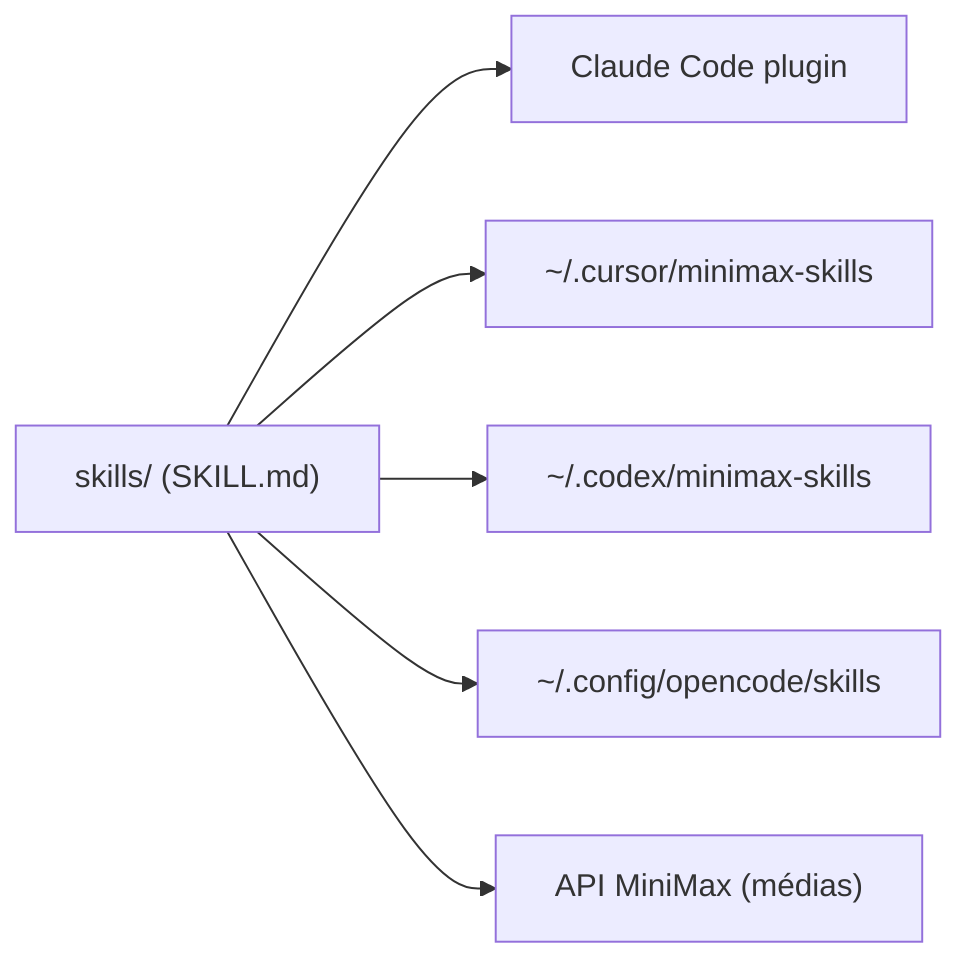

# MiniMax-AI/skills

> Skills de développement (front, back, mobile, shaders, documents) pour agents de code, dont certains appellent l'API MiniMax.

## Le problème
Les agents de code produisent des interfaces et des documents moyens sans consignes structurées par domaine.

## Ce que ça fait vraiment
Un lot de skills : frontend-dev, fullstack-dev, Android, iOS, Flutter, React Native, shader-dev, génération de PDF, PPTX, XLSX, DOCX. D'autres (musique, vidéo, TTS, GIF, vision) passent par l'API MiniMax. Installation via marketplace Claude Code, clone pour Cursor, Codex et OpenCode. Le README se déclare en bêta.

## Comment c'est branché


## Essayer
```bash
claude plugin marketplace add https://github.com/MiniMax-AI/skills
claude plugin install minimax-skills
```

## Coût et pièges
Les skills médias exigent une clé MiniMax payante côté usage. Formats et configs « peuvent changer sans préavis » (bêta). Dernier push le 2026-04-18.

## Ce que ce n'est pas
Ce n'est pas un seul outil mais un assortiment : les skills documents (pdf, pptx, xlsx, docx) sont utilisables sans MiniMax, les autres pas.

## Alternatives
Aucune alternative nommée dans le README.

## Pour toi
À surveiller : les skills documents sont réutilisables en data, le reste t'enferme dans l'API MiniMax.

