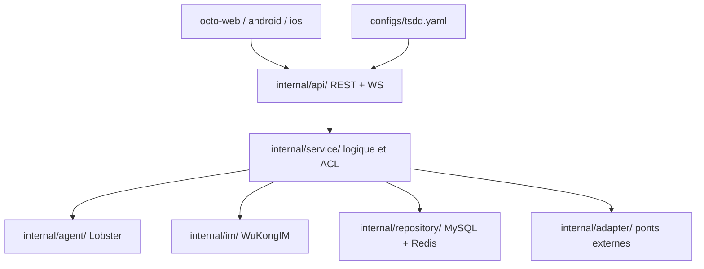

# Mininglamp-OSS/octo-server

> Go backend of a messaging platform where AI agents take part in conversations.

## The problem
Adding an agent to an enterprise messaging tool is usually done with a bot bolted on next to the routing.
The agent is then neither authenticated, nor authorized, nor logged as a full participant.

## What it actually does
Exposes REST and WebSocket APIs consumed by the web, admin, Android and iOS clients, and drives the WuKongIM messaging core through a thin control plane.
Orchestration of the "Lobsters" — digital twins powered by OpenClaw — is built into the server: routing, session and execution of tool calls.
Each request goes through five steps: authentication (token, cookie or DH-sealed WebSocket frame), organization-aware RBAC authorization, execution, IM broadcast, unified JSON response with tracing.
Pluggable storage: MySQL-compatible SQL migrations and object-storage adapters shipped by default.

## How it is wired


## Trying it
```bash
git clone https://github.com/Mininglamp-OSS/octo-server.git
cd octo-server
go build -o octo-server .
./octo-server --config ./configs/tsdd.yaml
```

## Cost and gotchas
The development configuration expects a local WuKongIM instance and a MySQL-compatible database.
The full stack (server, admin, web, matter, smart-summary, WuKongIM, MySQL, Redis, MinIO, nginx) lives in a separate `octo-deployment` repository; the old `docker/octo/` and `docker/tsdd/` have been removed.

## What it is not
Not a standalone product: it is one building block among nine repositories, and the IM itself is WuKongIM.
Not a new project: it is derivative work of TangSengDaoDaoServer, under Apache 2.0, with a license inventory in NOTICE.
Not a complete local platform: the "local-first" principle is advertised, but the agents rely on OpenClaw.

## Alternatives
- TangSengDaoDaoServer: the upstream project, if the agent layer is not needed.
- WuKongIM: the messaging core alone, if only real time matters.

## For you
Too tightly coupled to its own stack for data / AI use; nothing in it is reusable in isolation.
