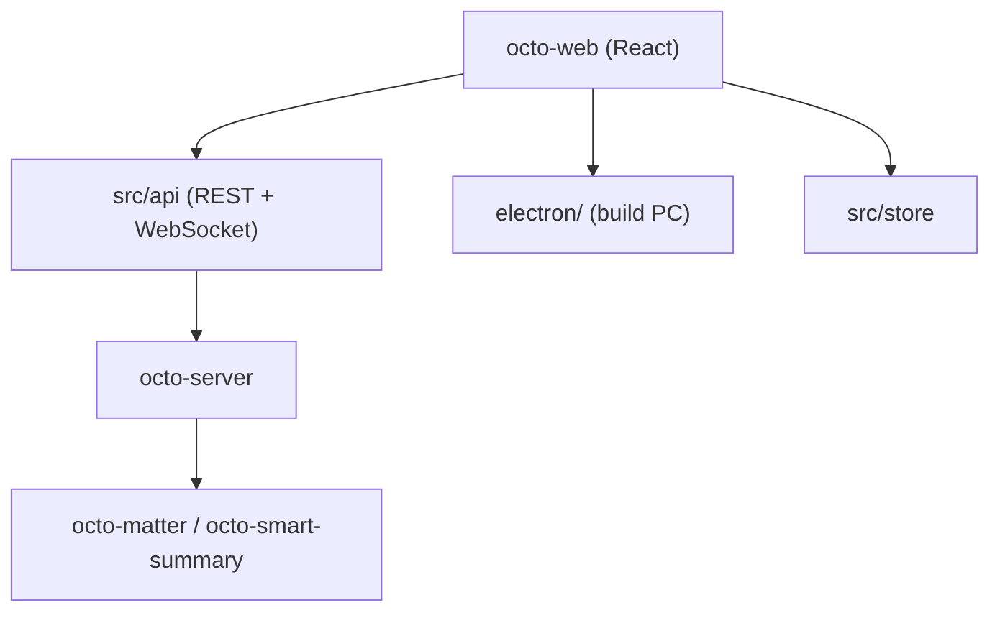

# Mininglamp-OSS/octo-web

> Web and Electron client of the OCTO messaging platform, designed for humans and AI agents.

## The problem
A workspace where humans and AI agents converse needs a suitable interface (streamed answers, tool calls).

## What it actually does
A React/TypeScript front end that talks to `octo-server` over REST and WebSocket. The same code produces a browser build and an Electron desktop client. It displays streamed agent answers, previews of tool calls and agent/human badges, in English and Simplified Chinese.

## How it is wired
Simplified diagram based on the sheet, no diagram provided.



## Trying it
```bash
git clone https://github.com/Mininglamp-OSS/octo-web.git
cd octo-web
pnpm install
pnpm dev
pnpm pc:dev
```

## Cost and gotchas
Free, but useless without an accessible `octo-server` instance (by default `http://localhost:8080`), to be configured via `.env.local`.

## What it is not
Not a standalone product: it is only the client, the backend is another repo. Young (created in May 2026).

## Alternatives
No alternative named in the README, apart from TangSengDaoDaoWeb from which it derives.

## For you
Ignore: a simple messaging interface tied to a separate backend; little interest for a data/MLOps profile.
