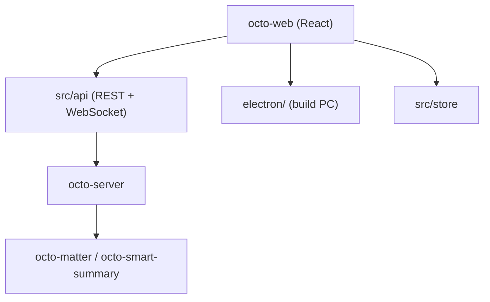

# Mininglamp-OSS/octo-web

> Client web et Electron de la plateforme de messagerie OCTO, pensée pour humains et agents IA.

## Le problème
Un espace de travail où humains et agents IA conversent a besoin d'une interface adaptée (réponses en flux, appels d'outils).

## Ce que ça fait vraiment
Un front React/TypeScript qui parle à `octo-server` en REST et WebSocket. Le même code produit un build navigateur et un client de bureau Electron. Il affiche des réponses d'agents en flux, des aperçus d'appels d'outils et des pastilles agent/humain, en anglais et chinois simplifié.

## Comment c'est branché
Schéma simplifié d'après la fiche, sans diagramme fourni.



## Essayer
```bash
git clone https://github.com/Mininglamp-OSS/octo-web.git
cd octo-web
pnpm install
pnpm dev
pnpm pc:dev
```

## Coût et pièges
Gratuit, mais inutile sans une instance `octo-server` accessible (par défaut `http://localhost:8080`), à configurer via `.env.local`.

## Ce que ce n'est pas
Pas un produit autonome : c'est seulement le client, le backend est un autre dépôt. Jeune (créé en mai 2026).

## Alternatives
Aucune alternative nommée dans le README, hormis TangSengDaoDaoWeb dont il dérive.

## Pour toi
Ignorer : simple interface de messagerie liée à un backend à part ; peu d'intérêt pour un profil data/MLOps.

