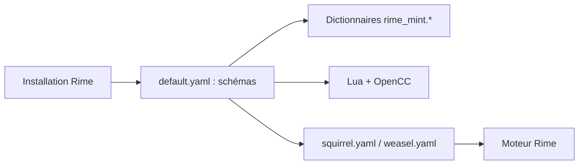

# Mintimate/oh-my-rime

> Ready-to-use configuration for the Rime input engine, with several Chinese input methods.

## The problem
Configuring Rime by hand (schemas, dictionaries, skins) takes a long time.

## What it actually does
Provides schemas: full pinyin (default), Xiaohe double pinyin, Earth Pinyin, Wubi 86 and 98, and a 9-key grid for Hamster. Dictionaries come from the Wanxiang lexicon (since 2025-07-09); Lua extensions, OpenCC conversion for emojis, skins for Squirrel and Weasel. The lexicon change is incompatible: the user database must be migrated.

## How it is wired

## Trying it
No documented command. README steps: install Rime, copy the files into the Rime config folder, redeploy.

## Cost and gotchas
Free. Avoid modifying the shipped files: use `*.custom.yaml`. Windows 7/XP do not support all features. README in Chinese.

## What it is not
Not an input engine: you need Rime. Not a language model project, even though using a grammar model is recommended.

## Alternatives
- rime-ice (雾凇拼音): long-term lexicon, cited as a recommendation.
- 98五笔: better for Wubi according to the README.

## For you
Ignore unless you type Chinese: no link with data/AI.
