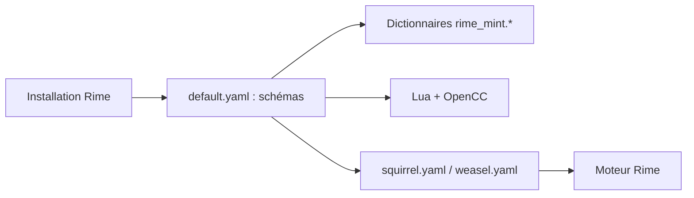

# Mintimate/oh-my-rime

> Configuration prête à l'emploi pour le moteur de saisie Rime, avec plusieurs méthodes de saisie chinoise.

## Le problème
Configurer Rime à la main (schémas, dictionnaires, skins) est long.

## Ce que ça fait vraiment
Fournit des schémas : pinyin complet (par défaut), double pinyin Xiaohe, Earth Pinyin, Wubi 86 et 98, et grille 9 touches pour Hamster. Les dictionnaires viennent du lexique Wanxiang (depuis 2025-07-09) ; extensions Lua, conversion OpenCC pour les emojis, skins pour Squirrel et Weasel. Le changement de lexique est incompatible : il faut migrer la base utilisateur.

## Comment c'est branché

## Essayer
Aucune commande documentée. Étapes du README : installer Rime, copier les fichiers dans le dossier de config Rime, redéployer.

## Coût et pièges
Gratuit. Éviter de modifier les fichiers livrés : utiliser des `*.custom.yaml`. Windows 7/XP ne supportent pas toutes les fonctions. README en chinois.

## Ce que ce n'est pas
Pas un moteur de saisie : il faut Rime. Pas un projet de modèle de langage, même si l'usage d'un modèle de grammaire est conseillé.

## Alternatives
- rime-ice (雾凇拼音) : lexique long terme, cité comme recommandation.
- 98五笔 : meilleur pour Wubi selon le README.

## Pour toi
À ignorer sauf saisie chinoise : aucun lien avec data/IA.

