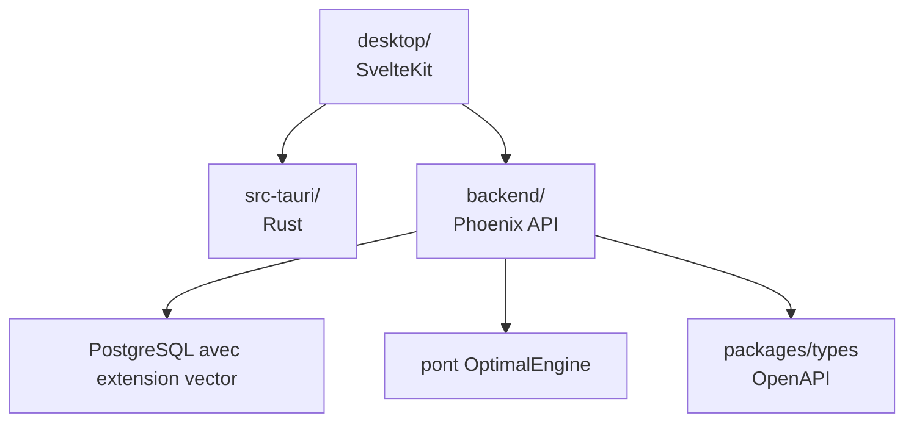

# Miosa-osa/canopy

> Desktop workspace for terminal sessions, agent runtimes and git worktrees, focused on session resumption.

## The problem
Restarting loses terminal sessions and in-progress agent conversations.

## What it actually does
Elixir/Phoenix backend, SvelteKit interface, Rust Tauri shell. Implemented: session snapshots, guarded restore, scrollback storage, workspace state, a bridge to OptimalEngine. The README states that full restoration is not proven end to end.

## How it is wired


## Trying it
```bash
make doctor
python3 scripts/agent_control_plane.py
make setup
cd backend && mix phx.server
cd desktop && pnpm dev
```

## Cost and gotchas
PostgreSQL with the `vector` extension is required. The README claims Apache 2.0, but GitHub does not recognize the license: to be checked. Mix, pnpm and Rust must be installed.

## What it is not
Not a proven solution: modules outside Build are hidden from the navigation. Browser mode has no native folder picker.

## Alternatives
Not documented in the README.

## For you
One to watch: session continuity for agents is useful, but the project is young and its license unclear.
