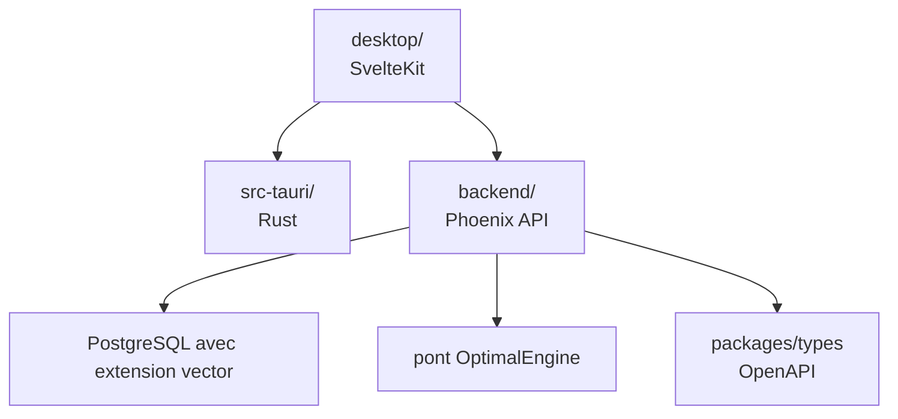

# Miosa-osa/canopy

> Espace de travail de bureau pour sessions de terminal, runtimes d'agents et worktrees git, centré sur la reprise de session.

## Le problème
Redémarrer perd les sessions de terminal et les conversations d'agents en cours.

## Ce que ça fait vraiment
Backend Elixir/Phoenix, interface SvelteKit, coque Tauri en Rust. Implémenté : instantanés de session, restauration gardée, stockage du défilement, état d'espace de travail, pont vers OptimalEngine. Le README précise que la restauration complète n'est pas prouvée de bout en bout.

## Comment c'est branché


## Essayer
```bash
make doctor
python3 scripts/agent_control_plane.py
make setup
cd backend && mix phx.server
cd desktop && pnpm dev
```

## Coût et pièges
PostgreSQL avec extension `vector` requise. Le README annonce Apache 2.0, mais GitHub ne reconnaît pas la licence : à vérifier. Mix, pnpm et Rust à installer.

## Ce que ce n'est pas
Pas une solution prouvée : les modules hors Build sont masqués de la navigation. Le mode navigateur n'a pas de sélecteur de dossier natif.

## Alternatives
Non documenté dans le README.

## Pour toi
À surveiller : la continuité de session pour agents est utile, mais le projet est jeune et sa licence floue.

