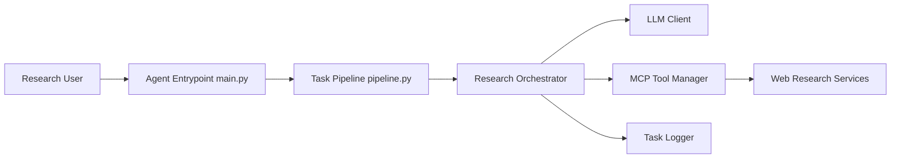

# MiroMindAI/MiroThinker

> Deep-research agent models (30B, 235B) and the MiroFlow framework to run and evaluate them.

## The problem
Open research agents handle long chains of tool calls poorly and remain behind commercial offerings.

## What it actually does
MiroThinker models (derived from Qwen3) with 256K context and up to 300 tool calls per task, served via SGLang or vLLM. The `apps/miroflow-agent` framework chains LLM reasoning with MCP servers (E2B sandbox, Serper search, Jina scraping with a summarizer LLM) and keeps only the last K tool results in context. Evaluation scripts for about a dozen benchmarks and trace collection for SFT/DPO.

## How it is wired


## Trying it
```bash
git clone https://github.com/MiroMindAI/MiroThinker
cd MiroThinker/apps/miroflow-agent
uv sync
cp .env.example .env
uv run python main.py llm=qwen-3 agent=mirothinker_1.7_keep5_max200 llm.base_url=http://localhost:61002/v1
```

## Cost and gotchas
Three third-party services are mandatory even in the minimal config (Serper, Jina, E2B), plus a summarizer LLM; OpenAI for evaluations. Serving the model requires several GPUs (the example uses 4).

## What it is not
Not an autonomous offline agent: research depends on paid APIs. MiroThinker-H1, the best-performing one, is proprietary.

## Alternatives
No named alternative; the agents mentioned (WebThinker, WebSailor...) only appear in score tables.

## For you
Worth watching: the "keep the last K tool results" trick and the evaluation suite are reusable, but the dependence on three SaaS services and the GPU cost limit direct adoption.
