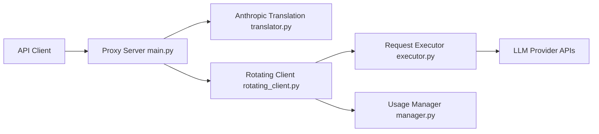

# Mirrowel/LLM-API-Key-Proxy

> Self-hosted proxy exposing OpenAI- and Anthropic-compatible APIs in front of several providers, with key rotation.

## The problem
Each tool (Claude Code, Cursor, Continue) is tied to one provider, and a key's rate limits block heavy usage.

## What it actually does
A FastAPI application with `/v1/chat/completions` and `/v1/messages`. The `provider/model` prefix routes to Gemini, OpenAI, Anthropic, OpenRouter or any provider handled by LiteLLM. Key rotation, failover on error, increasing cooldowns, quotas per model group, usage tracking and a TUI. Reusable `rotator_library` library. Gemini CLI provider via OAuth.

## How it is wired


## Trying it
```bash
cp .env.example .env
mkdir usage
docker compose up -d
# puis pointer le client sur http://127.0.0.1:8000/v1 avec PROXY_API_KEY
```

## Cost and gotchas
Calls are still billed by each provider. You must supply your own keys and a `PROXY_API_KEY`. The Gemini CLI provider goes through OAuth credentials: check Google's terms of use. The proxy listens on 0.0.0.0 by default.

## What it is not
Not a free tool for accessing models: it provides no credit. Multiplying accounts to get around quotas may breach terms of service. Usage statistics are still alpha.

## Alternatives
No alternative named in the README (LiteLLM is used as a fallback layer).

## For you
Adopt it to try out: a single entry point for your coding clients and notebooks, easy to launch with Docker; check the licence first and limit network exposure.
